# tonight-sky — 今晚的月亮

一幅用本地星历数据画出来的“真实天象”海报生成器与天体力学计算工具箱。
支持任意日期/时间/坐标计算，默认呈现东部沿海（31.2°N 121.5°E）夜空。

## 视觉效果（渐盈至望 · 十日完整月相与大潮长卷）

**前期渐盈阶段（八月初九至十二）**

| 2026-09-19 (八月初九 · 57.1%) | 2026-09-20 (八月初十 · 66.3%) | 2026-09-21 (八月十一 · 75.1%) | 2026-09-22 (八月十二 · 83.0%) |
| :---: | :---: | :---: | :---: |
| 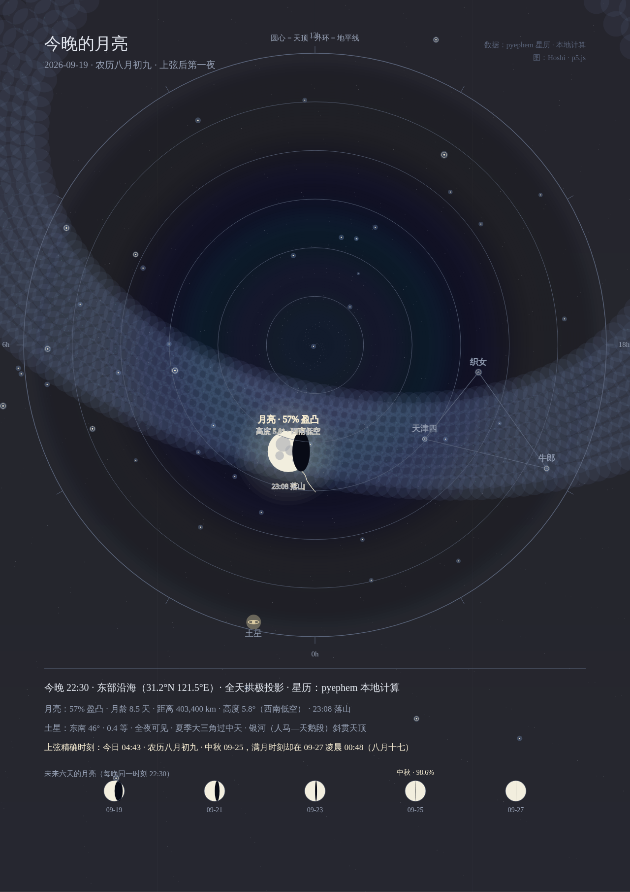 | 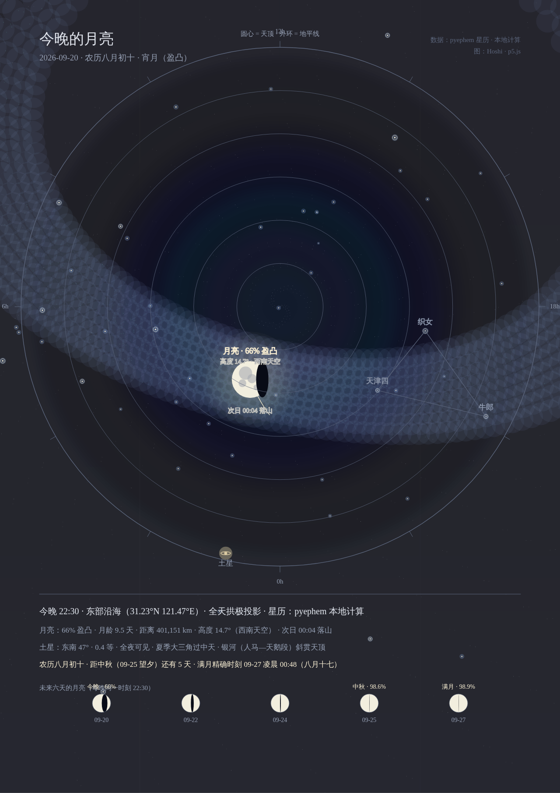 | 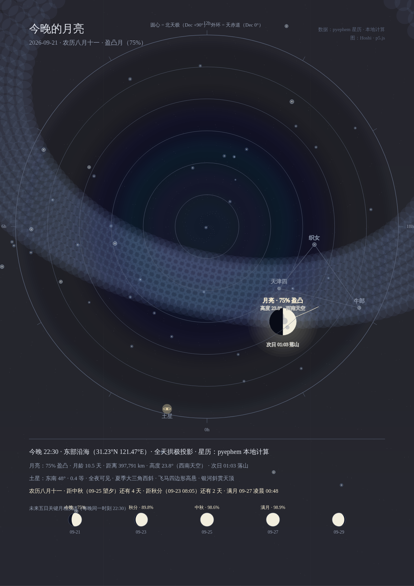 | 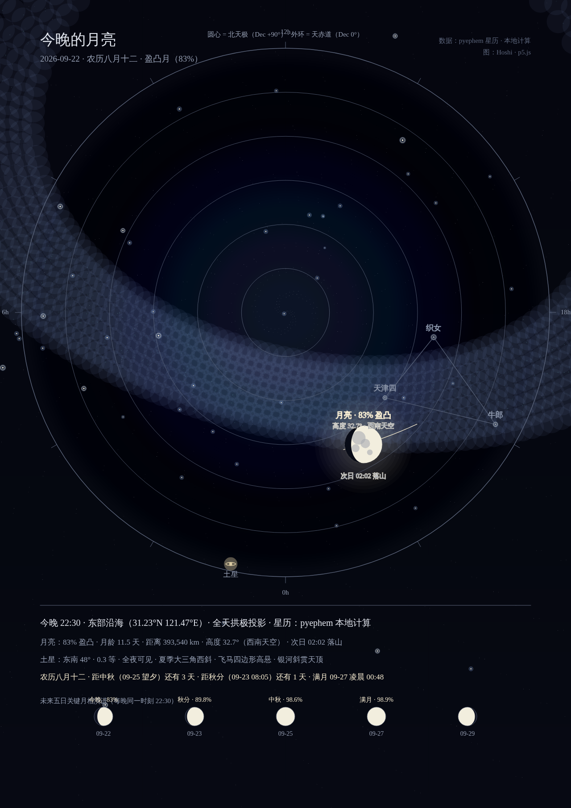 |

**中秋、满月、大潮至望后渐亏阶段（秋分、中秋、既望、满月、十八大潮至十九亏凸）**

| 2026-09-23 (秋分 · 89.8%) | 2026-09-24 (十四 · 95.1%) | 2026-09-25 (中秋 · 98.6%) | 2026-09-26 (既望 · 99.9%) | 2026-09-27 (满月 · 98.9%) | 2026-09-28 (大潮 · 95.4%) | 2026-09-29 (十九 · 89.5%) |
| :---: | :---: | :---: | :---: | :---: | :---: | :---: |
| 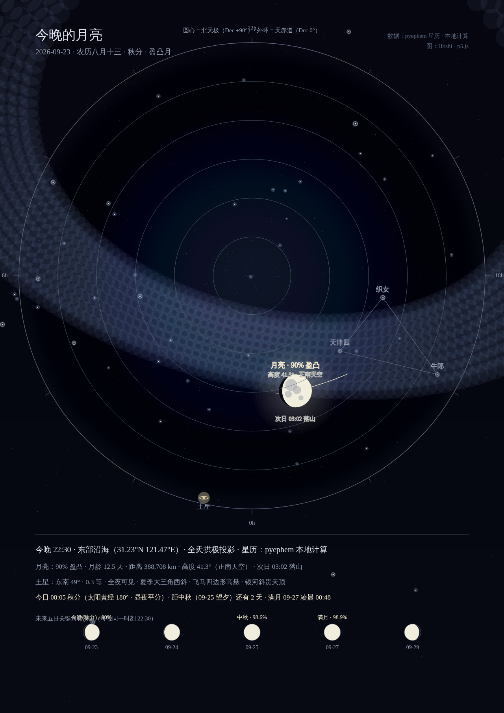 | 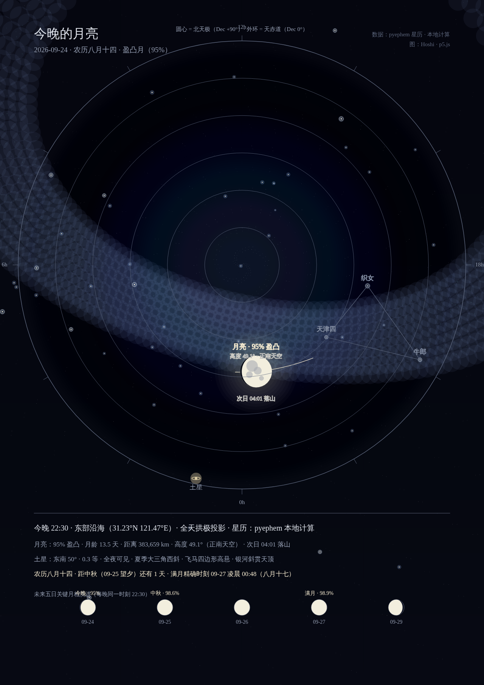 | 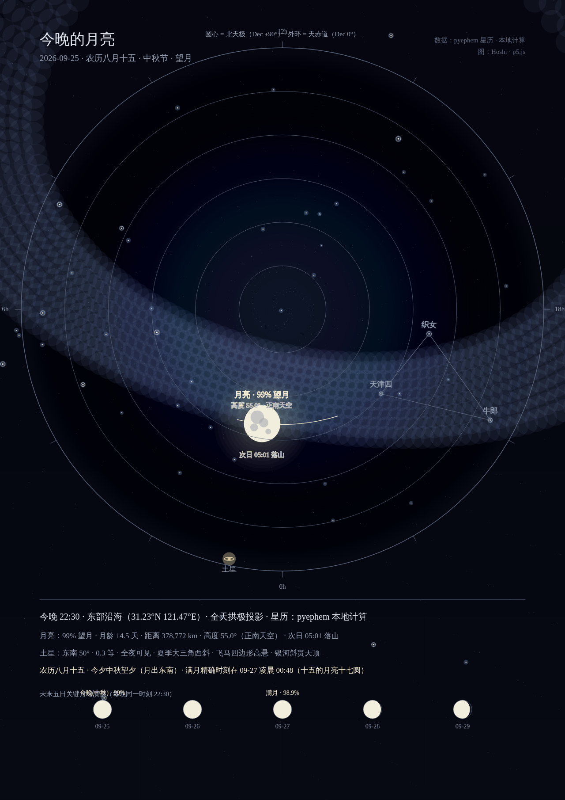 | 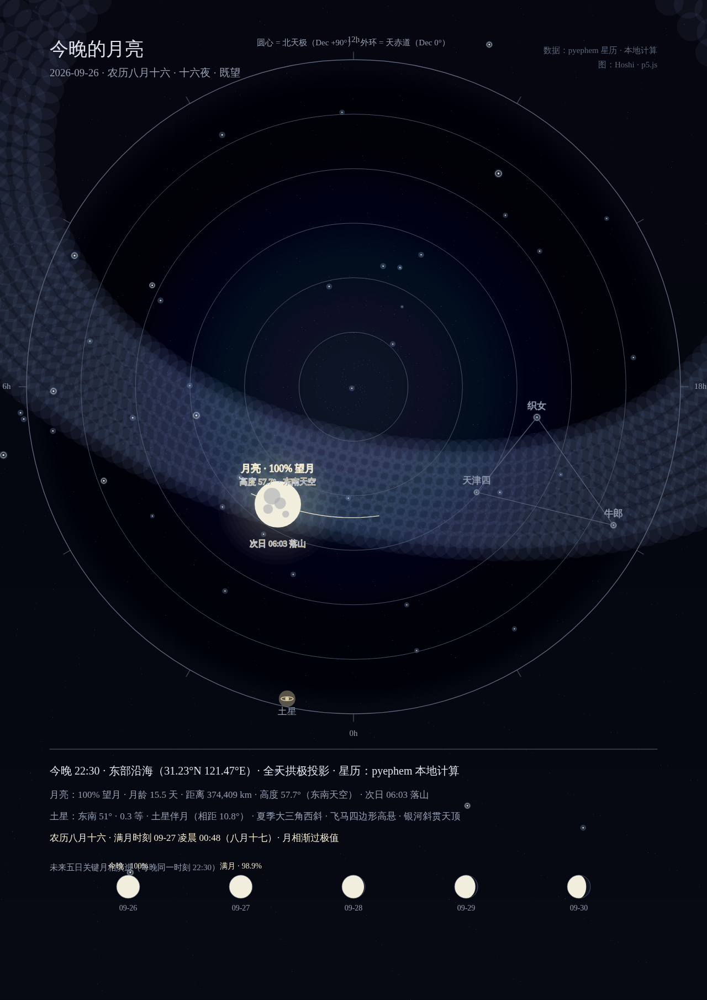 | 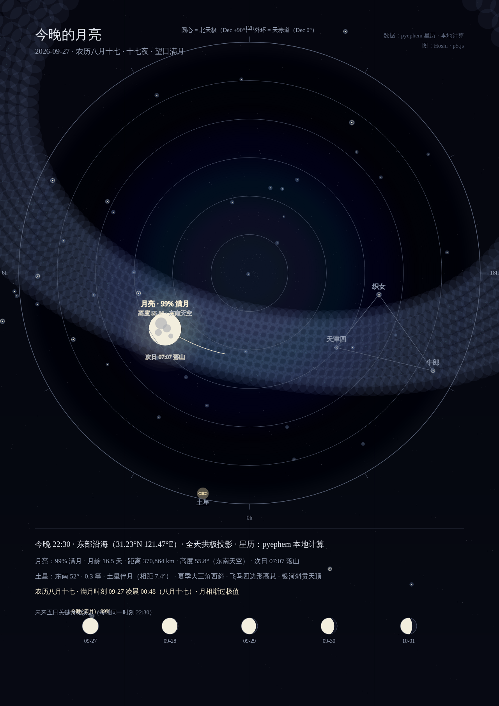 | 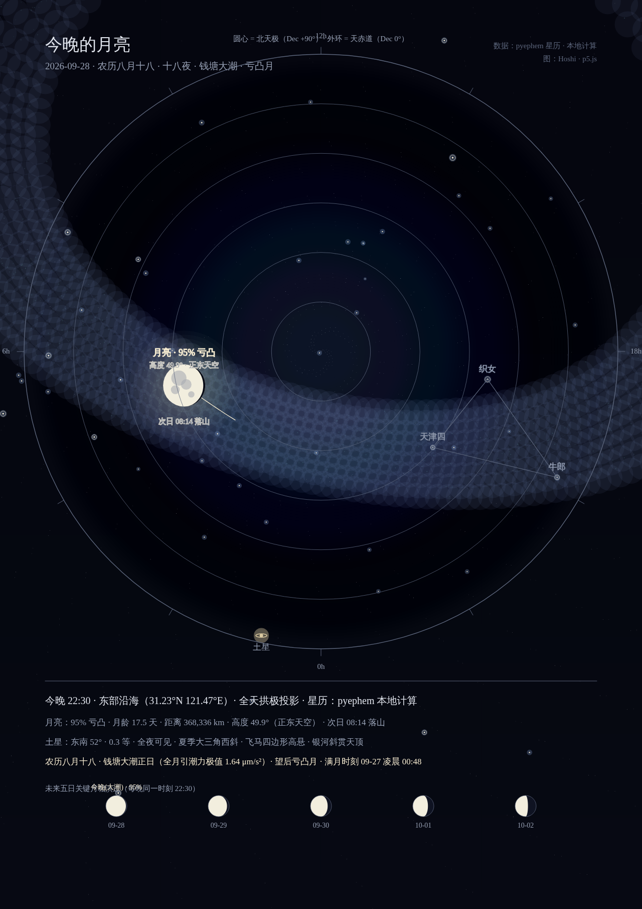 | 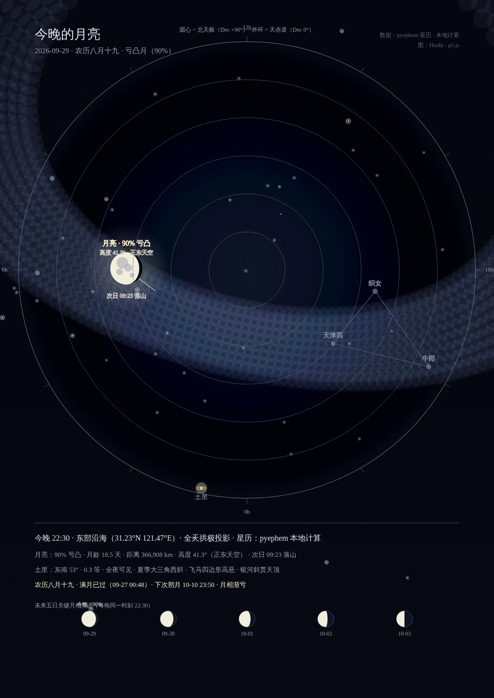 |

## 产物与天体动力学套件

- `tonight-moon-2026-10-26.png` — 农历九月十七猎人满月正日海报（100% 满月 · 2026 年度超级满月三部曲首曲 · 精确望月时刻 12:11:44 CST · 地月距离 373,104 km · 视直径 32.06 角分 · 上海夜间 22:30 CST 中天仰角 67.1° 东南天高悬照耀 · 神舟十七号发射 3 周年华诞，汤洪波/唐胜杰/江新林在轨 187 天完成空间站首次舱外太阳翼试验性修复 · 卡西尼号 Cassini 首次近距离雷达探测泰坦土卫六 Ta 飞掠 22 周年，1,174 km 近心点 Ku 波段合成孔径雷达穿透氮甲烷浓雾揭示碳氢湖泊与沙丘 · 日地关系天文台 STEREO 双星发射 20 周年正日）
- `tonight-moon-2026-10-25.png` — 农历九月十六望月前夕海报（98.1% 照亮 · 日地关系天文台 STEREO 双星发射 20 周年双十瓷婚纪念日 · 7,305 天日心超前漂移与 21.18 轮日心公转 · 68.20° 超前角与 1.098 AU 空间基线 · 太阳远背面活动区 5.17 天超前预警 · 双重视角全日面 68.9% 经度覆盖 · 金星十号 Venera 10 着陆金星 Beta Regio 51 周年正日 · 9.0 MPa 90 大气压 / 465°C 下相变储热超额生存 65 分钟 · 人类第二幅外星地表 180° 全景图与玄武岩熔岩薄板 2.8 g/cm³ 实测 · 地表微风 0.8~1.3 m/s · 距明晨 10-26 12:11 CST 猎人满月仅剩 1 天）

- `tonight-moon-2026-10-22.png` — 农历九月十三盈凸月海报（85.2% 照亮 · 月船一号 Chandrayaan-1 今日发射 18 周年整成年礼 & NASA M3 光谱仪首确证月表 2.8~3.0 μm 水分子/羟基吸收带 & MIP 南极沙克尔顿坑撞击 & 2017 JPL 地基深空雷达在轨找回 · 金星九号 Venera 9 历史性首张外星地表全景图与极端地狱工程 51 周年正日，9.0 MPa 90 大气压 / 485°C 下相变储热超额生存 53 分钟 · 2026 猎户座流星雨 Orionids 极盛主峰夜哈雷彗星 66.0 km/s 超高速逆行尘埃流 · 华夏各大省市后半夜月落后独享 2.5~3.0 小时 100% 零月光纯黑暗空天窗与辐射点中天仰角极值 65°~83° · 距 10-24 火星奥德赛号 25 周年银禧 2 天 · 距 10-26 近地超级满月 4 天 · 02:45 月落后通宵零月光纯黑暗空）
- `tonight-moon-2026-10-21.png` — 农历九月十二盈凸月海报（77.2% 照亮 · 2026 猎户座流星雨 Orionids 今夜迎来极大期极盛 · 哈雷彗星 66.0 km/s 超高速逆行尘埃流 · 华夏各大省市后半夜月落后独享 2.5~3.0 小时 100% 零月光纯黑暗空天窗与辐射点中天仰角极值 66°~83° · 联盟号法属圭亚那首飞 15 周年晶婚纪念日 VS01/伽利略导航卫星 IOV 首批入轨 · 联盟 TM-33 载人飞船发射 25 周年银禧仙女座 Andromède 任务首位欧洲女宇航员访 ISS · 深空舰队第 52 极 CAPSTONE 地月南向近直线晕轨道 NRHO 稳定运行四周年、CAPS 自主导航与深空软件定义卫星 · 距 10-24 火星奥德赛号 25 周年银禧 3 天 · 距 10-26 近地超级满月 5 天 · 01:46 月落后通宵零月光纯黑暗空）
- `tonight-moon-2026-10-20.png` — 农历九月十一盈凸月海报（68.3% 照亮 · 今日凌晨 03:41 CST MMX 火星卫星探测器搭载 H3-24L 破晓升空开启人类首个火星系统采样返回航程 & 贝皮可伦坡 BepiColombo 今日迎来发射 8 周年整锡婚正日水星捕获倒计时 32 天 & OSIRIS-REx 贝努小行星触碰采样 TAG 今日迎来 6 周年整 · 距 10-21 猎户座流星雨极盛仅剩 1 天 / 24 小时倒计时 · 距 10-24 火星奥德赛号 25 周年银禧 4 天 · 距 10-26 近地超级满月 6 天 · 次日 00:48 月落后华夏夜空迎来通宵零月光纯黑暗空）
- `tonight-moon-2026-10-19.png` — 农历九月初十盈凸月海报（59.0% 照亮 · ExoMars 痕量气体轨道器 TGO 今日入轨 10 周年整锡婚纪念日 & 星际边界探测器 IBEX 今日发射 18 周年整成人礼 · ESCAPADE 双星 Blue & Gold 日地 L2 驻留-奥伯特飞掠轨道、火星立体磁层动力学与 2026 人类深空五十极半百黄金舰队 The Grand Quinquagintet 宏伟全景推演 · 鹊桥一号、嫦娥三号 LUT、TESS 协同对齐 · 距 10-21 猎户座流星雨极盛 2 天 · 距 10-24 火星奥德赛号 25 周年银禧 5 天 · 距 10-26 近地超级满月 7 天 · 23:49 月落后通宵零月光纯黑暗空）
- `tonight-moon-2026-10-18.png` — 农历九月初九重阳节盈凸月海报（40.8%~49% 照亮 · 旅行者 2 号今日凌晨 00:17 CST 正式突破 20 光时星际大关 · 火星快车号/奥德赛号/ExoMars TGO/MAVEN/希望号火星九极联动 · 月球现役六大金刚 The Lunar Hexad 与 2026 人类深空三十四极黄金舰队 The Grand Quattuortrigintet 全景推演 · 距 10-21 猎户座流星雨极盛 3 天 · 距 10-26 近地超级满月 8 天 · 22:51 月落后通宵零月光纯黑暗空）
- `tonight-moon-2026-10-17.png` — 农历九月初八上弦月海报（39.0% 照亮 · 日地关系天文台 STEREO-A 20 周年日心超前漂移轨道天体力学、CME 3D 立体视觉重构、太阳远背面 5.2 天超前预警、SECCHI 空间光学与 2026 人类深空二十五极黄金舰队 The Grand Quinvigintet 全景推演 · 旅行者 2 号 20 光时终极跨越今晚 4 小时后准时冲线 · 距 10-21 猎户座流星雨极盛 4 天 · 距 10-26 近地超级满月 9 天 · 21:54 月落后通宵零月光纯黑暗空）
- `tonight-moon-2026-10-16.png` — 农历九月初七蛾眉月海报（31.0% 照亮 · 太阳轨道飞行器 Solar Orbiter 黄道外极区发电机动力学、520°C 骨黑热障与 2026 人类深空十五极黄金舰队 The Grand Sedecet 全景推演 · 倒计时 69 天平安夜迎来 VGA5 开启 24° 极区新时代 · 距 10-21 猎户座流星雨极盛 5 天 · 距 10-26 近地超级满月 10 天 · 通宵零月光纯黑暗空）
- `tonight-moon-2026-10-15.png` — 农历九月初六蛾眉月海报（22.7% 照亮 · 詹姆斯·韦伯望远镜 JWST 日地 L2 晕轨道天体力学、极寒隔热与 2026 深空七极黄金舰队全景推演 · 今日赫拉号 BRM-1 主减速点火 · 距 10-21 猎户座流星雨极盛 6 天 · 通宵零月光纯黑暗空）
- `tonight-moon-2026-10-14.png` — 农历九月初五蛾眉月海报（14.5% 照亮 · 帕克太阳探测器 2026 极限近日点日冕穿越与双极对偶推演 · 距 10-19 远日点仅 5 天 · 通宵零月光纯黑暗空）
- `tonight-moon-2026-10-13.png` — 农历九月初四蛾眉月海报（9.0% 照亮 · 今日清晨 06:40 4 号灶神星冲日夜海报 · 通宵零月光纯黑暗空）
- `tonight-moon-2026-10-12.png` — 农历九月初三蛾眉月海报（4.0% 照亮 · 朔后新生蛾眉月 · 明晨 4 号灶神星冲日夜海报）
- `tonight-moon-2026-10-11.png` — 农历九月初二极细蛾眉月海报（0.5% 照亮 · 荧惑深入鬼宿核心致密区夜海报）
- `tonight-moon-2026-10-10.png` — 农历九月三十新月前夕极黑天幕海报（0.1% 残月 · 朔日前夕 · 深空纯黑夜海报）
- `tonight-moon-2026-09-29.png` — 八月十九亏凸月海报（89.5% 亏凸月 · 望后渐亏阶段）
- `tonight-moon-2026-09-28.png` — 八月十八钱塘大潮夜海报（95.4% 亏凸月 · 全月引潮力极值 1.64 μm/s²）
- `tonight-moon-2026-09-27.png` — 八月十七望日满月海报（98.9% · 精确满月 00:48 CST）
- `tonight-moon-2026-09-26.png` — 八月十六既望海报（99.9% 盈顶 · 极近满月）
- `tonight-moon-2026-09-25.png` — 中秋节望月海报（98.6% · 农历八月十五望夕）
- `tonight-moon-2026-09-24.png` — 八月十四海报（盈凸月 95.1%）
- `tonight-moon-2026-09-23.png` — 八月十三·秋分海报（盈凸月 89.8%）
- `tonight-moon-2026-09-22.png` — 八月十二海报（盈凸月 83.0%）
- `tonight-moon-2026-09-21.png` — 八月十一海报（盈凸月 75.1%）
- `tonight-moon-2026-09-20.png` — 八月初十海报（宵月 66.3%）
- `tonight-moon-2026-09-19.png` — 八月初九海报（上弦后首夜 57.1%）
- `sketch.html` — 自包含单文件页（p5.js 1.11.3 CDN + 内嵌数据），浏览器直接打开即可重渲染
- `sky-data.json` — pyephem 计算的全部天体数据
- **天体力学脚本集 (`scripts/`)**：
  - `venera10_beta_regio_lava_plain_engine.py` — 金星十号 (Venera 10) 着陆金星地表 51 周年、玄武岩熔岩平原全景成像与 92 大气压超临界流体极端环境热工动力学推演引擎：1975-10-25 05:17 UTC 降落于 Beta Regio (15.42° N, 291.51° E)，轨道器成功切入金星环绕轨道 (49.3 小时周期, 1,620 km × 113,930 km, i=29.5°)，建立首批金星空间数字中继链路；10.7 km/s 高速双曲再入金星大气，承受 ~168 g 峰值减速过载；50 km 高度抛弃减速伞，依靠 2.1 米圆盘形减速板在 65.0 kg/m³ 超浓密低空大气中自由落体，地表终端沉降速度 6.58 m/s (23.7 km/h)，碰撞动能 14.3 kJ 由底部环形金属压皱吸能环塑性吸收；9.0 MPa (90 大气压) 与 465°C 下三水合硝酸锂 (LiNO3·3H2O) 相变蓄冷 9.8 MJ，地表超额稳定运行 65 分钟；传回人类历史上第二幅外星地表 180° 全景图，确认大面积平坦硬化的玄武岩熔岩薄板与细粒风化土壤，实测岩石密度 2.8 ± 0.1 g/cm³，风速仪测得地表风速 0.8~1.3 m/s (动压 20.8~54.9 Pa)；同步推演 STEREO 双星 20 周年正日 7,305 天服役、68.20° 超前角与 5.17 天太阳远背面预警动力学。
  - `chandrayaan1_venera9_orionids_peak_engine.py` — 月船一号 (Chandrayaan-1) 发射 18 周年整成年礼与月表水分子/羟基开创性光谱发现、金星九号 (Venera 9) 历史性外星地表首张全景图与极端地狱温压工程 51 周年、以及 2026 猎户座流星雨极大期主峰夜 (Orionids Peak Night) 华夏全景天体力学推演引擎：月船一号 2008-10-22 发射 18 周年成年礼，PSLV-XL (C11) 五级地球变轨升高远地点 (22,860 km -> 380,000 km) 与地月中继注入 (TLI)，近月制动 (LOI, Delta-V ≈ 370.2 m/s) 切入 100 km 极月圆形环绕轨道 (T = 117.8 min, v = 1.634 km/s)，NASA M3 光谱仪在 2.8~3.0 μm 谱段首次确证月表水分子与羟基吸收特征，MIP 撞击器 1.69 km/s 撞击沙克尔顿坑原位质谱探测水蒸气，2017 年 NASA JPL 地基深空雷达跨越 7.5 年在轨寻回；金星九号 1975-10-22 降落 51 周年，10.7 km/s 高速双曲再入金星超密 CO2 大气承受 168 g 峰值过载，50 km 高空切断降落伞利用 2.1 米圆盘形减速板在 65 kg/m³ 超高密度大气中自由落体终端撞击速度仅 6.58 m/s (23.7 km/h)，环形金属吸能环吸收 14.3 kJ 动能平稳触地，9.0 MPa (90 大气压) 与 485°C (758 K) 极端地狱温压下三水合硝酸锂 (LiNO3·3H2O) 相变储热吸热 9.8 MJ 超额生存 53 分钟，人类首传 180° 外星表面全景图；2026 猎户座流星雨极大期主峰夜，哈雷彗星逆行冰尘 66.0 km/s 超高速对冲地球，单位动能密度 2.18 GJ/kg (520x TNT 当量)，48% 高空电离持久余迹率，华夏各大城市后半夜月落后独享 2.5~3.0 小时 100% 纯黑天窗，辐射点中天仰角极值 65°~83°，仰角观测效率因子 0.88~0.99，ZHR ≈ 20~25。
  - `capstone_nrho_cislunar_soyuz_guiana_engine.py` — CAPSTONE 探测器地月近直线晕轨道 (NRHO) 动力学与 CAPS 自主导航、联盟号法属圭亚那首飞 15 周年晶婚 (VS01 / 伽利略导航双星 IOV-1/2) 赤道发射增益、联盟 TM-33 载人飞船银禧 25 周年 (Andromède 任务 / 克劳迪·艾涅尔首位欧洲女宇航员访 ISS) 与 2026 猎户座流星雨极大期华夏纯黑暗空天窗全景推演引擎：CAPSTONE 12U 微纳深空探测器 (25 kg) 在轨超 4 年，地月 L2 南向 9:2 朔望月共振近直线晕轨道 (NRHO, 周期 6.562 天，近月点北极高度 1602.6 km 速度 2.40 km/s，远月点南极高度 69662.6 km 速度 110 m/s 极度悬垂)，单值矩阵最大特征值 1.30 (李雅普诺夫时间 25 天)，年轨道维持速度增量预算 <=5 m/s/年，CAPS 与 LRO 双向微波测距时延 333.56 ms，人类首个深空软件定义卫星 (40万公里外远程重写星载 FPGA 比特流与替换操作系统内核)；联盟号法属圭亚那库鲁 CSG (5.24°N) 相对拜科努尔 (45.92°N) 获得 +139.61 m/s 地球自转线速度增益，GTO 倾角变轨速度增量削减 1246.5 m/s，齐奥尔科夫斯基增益使联盟号 GTO 运力由 1.7 吨跃升至 3.2 吨 (+88.2%)，伽利略 MEO 半长轴 29600 km 环绕速度 3.670 km/s 周期 14.08 小时；联盟 TM-33 载人飞船 2001-10-21 发射 25 周年银禧，克劳迪·艾涅尔完成首位欧洲女宇航员进驻 ISS 壮举与救生艇轮换；2026 猎户座流星雨极大期 (10-21/22)，77.2% 盈凸月于后半夜西沉，华夏全境独享 2.5~3.0 小时 100% 零月光纯黑暗空黄金天窗，辐射点正逢中天仰角极值 66°~83°，ZHR ~ 25。
  - `mmx_phobos_sample_return_engine.py` — 火星卫星探测任务 (MMX, Martian Moons eXploration - JAXA / NASA / CNES / DLR / ESA) 破晓启航天体力学、地火转移轨道 (TMI) 与火星捕获 (MOI)、火卫一 (Phobos) 准卫星轨道 (QSO, Quasi-Satellite Orbit) 2:1 相对逆行共振椭圆、希尔球极其狭窄性 (r_Hill ~ 16.59 km vs 火卫一长半轴 13.4 km，传统开普勒圆轨道物理崩溃)、三级 QSO 阶梯深度勘测 (QSO-H 100km / QSO-M 50km / QSO-L 20km)、德法联合 IDEFIX 漫游车 (25 kg 质量在火卫一表面微重力 0.0057 m/s² 下自重仅 0.144 N / 相当于地球 14.7 克，防弹跳低速爬行控制与主动双翼翻身复位机构)、双采样机构 (高压气动气吸式 + 机械深层钻芯) >=10 克风化层样本采集、古代火星大撞击喷射物 (Martian Ejecta) 汇聚捕获模型 (火卫一表土含约 0.5% 火星物质，10 克样本含约 50 毫克 / 420 万颗微观火星古矿物颗粒，实现免去火星引力井表面起飞的跨越 40 亿年火星地质盲盒采样)、2030 火星逃逸与 2031 澳大利亚伍默拉 (Woomera) 11.8 km/s 超第二宇宙速度非推力无伞抗冲击气动再入回收推演引擎。
  - `bepicolombo_8th_anniversary_osiris_tag_engine.py` — 贝皮可伦坡 (BepiColombo) 发射 8 周年整、9 次行星引力助推削减 93% 双曲过剩速度、MTM 推进舱抛离质量重构与推质比跃升 1.82 倍、水星引力捕获 (MOI) 倒计时 32 天 (弱稳定性边界 WSB 捕获仅需 445 m/s 节省超 6000 m/s 制动)、OSIRIS-REx 贝努小行星触碰采样 (TAG) 6 周年整 (121.6g 原始样本归地)、OSIRIS-APEX 0.50 AU 4倍日照洛马“无花果叶”热防御与 2029 阿波菲斯会合、2026 猎户座流星雨 24 小时极大期倒计时与华夏“月落-晨光黄金暗空天窗”推演引擎。
  - `queqiao1_change3_tess_grand_octoquadragintet_engine.py` — 鹊桥一号 (Queqiao-1) 地月第二拉格朗日点 (EML2) 大晕轨道 (Halo Orbit) 天体力学、荷中低频射电探测仪 (NCPE) 1~30 MHz 宇宙黑暗时代射电静默区视窗、嫦娥三号着陆器 (Chang'e-3 Lander) 雨海 (Mare Imbrium) 表面 13 载长巡传奇 (在轨运行近 13 年 4,692 天 / 158.9 个月昼夜周期，创地外天体表面寿命最长活动天文台世界纪录)、月基紫外望远镜 (LUT) 150mm f/3.75 近紫外巡天与全月球外逸层水汽极限 (< 10^11 cm^-2 / < 10^4 molecules/cm^3)、凌日系外行星巡天卫星 (TESS) 2:1 P/2 地月轨道共振大椭圆深轨动力学 (远地点 37.5 万公里与月球 90° 锁相避开引力瓦解、近地点 10.8 万公里超脱范艾伦辐射带零轨道维持零能耗维持数十年、发现 7,900+ 候选与 885 颗确认系外行星) 与 2026 人类深空四十八极终极黄金舰队 (The Grand Octoquadragintet / 人类深空四十八宿) 宏伟全景推演引擎：将全人类在深空、地月空间与日地拉格朗日点处于真实活动服役状态的全部 48 艘主力探测器按日心极距严格降序编目编队，完美对齐托勒密四十八经典星座 (Ptolemy's 48 Classical Constellations)；中国 CNSA 正式构建涵盖火星天问一号、小行星天问二号、地月 L2 鹊桥一号、环月冻结轨鹊桥二号、月球背面嫦娥四号/玉兔二号、月球正面嫦娥三号 LUT、月球 DRO 嫦娥五号与日地 L2 嫦娥六号的深空八极全景版图 (The CNSA Deep Space Octet)；极端物理对偶落差：日心极距跨度 3765.65 倍、太阳辐射能流落差 1418.01 万倍、通信单向光时跨度 67412.4 倍从 1.28 秒到 24.01 小时、帕克极速比 1998 KY26 逃逸速度超 2790.7 万倍、物理温差跨度超 1666.45 K。
  - `change5_change6_chandrayaan3_grand_quinquadragintet_engine.py` — 嫦娥五号轨道器 (Chang'e-5 Orbiter) 地月远距离逆行轨道 (DRO, 距月心 75,000 km 突破月球希尔球 61,524 km 却通过科里奥利力与地球潮汐共振实现 Lyapunov 线性稳定，年轨道维持 Delta-V < 1.5 m/s 零耗母港，在轨近 6 年 2,156 天，星载 VLBI 与中继测试)、嫦娥六号轨道器 (Chang'e-6 Orbiter, 月背采样返回 1,935.3g 功成后转战日地 L2 晕轨道 Halo Orbit 150 万公里，在轨 899 天，与 JWST/Euclid/Spektr-RG 构筑日地 L2 四大天王空间舰队)、月船三号推进舱 (Chandrayaan-3 PM, 2023 TEI 逆向跨地球注入与 2025 双月球自然引力弹弓跃入 36.5万x98.3万公里地月大椭圆深轨，SHAPE 载荷在 0.3~1.0 um 测量海洋 53.1° 布儒斯特角纯偏振、140° 彩虹云散射与 700nm 植被红边，建立活体宜居系外行星全景偏振地真) 与 2026 人类深空四十五极终极黄金舰队 (The Grand Quinquadragintet / 四十五极终极黄金舰队，涵盖 173.22 AU 旅行者 1 号至 0.046 AU 帕克太阳探测器，日心极距跨度 3765.65 倍、辐射能流落差 1418 万倍、单向光时跨度 67412.4 倍从 1.28 秒到 24.01 小时、帕克极速比 1998 KY26 逃逸速度超 2790.7 万倍，涵盖中国 6 极与印度 3 极深空矩阵)。
  - `ibex_interstellar_boundary_grand_duoquadragintet_engine.py` — 星际边界探测器 (IBEX) 18 载成人礼 (2008-10-19 升空，累计在轨 6,574 天 / 18.00 年)、3:1 月球共振轨道力学 (远地点 320,000 km / 50 Re / 0.832 月球轨道半径，周期 9.091 天严格 3:1 恒星月共振锁定避开月球希尔球引力瓦解零推进剂维持 15 载)、高能中性原子 (ENA) 电荷交换透镜动力学 (H+ + H0 -> H0_ENA + H+，1 keV 碰撞截面 2.0e-15 cm²，日鞘光程 40 AU，光学厚度 tau=0.1436 < 1.0 光学薄无损透视日球层深渊)、ENA 速度色散与跨年度时延 (100 eV 需 4.08 年，1 keV 需 1.29 年，4 keV 需 0.64 年，实证太阳 11 年活动周期边界响应时滞)、IBEX 能量带 (Ribbon) 垂直本星际磁场律 (B_ISMF . r = 0 二次 ENA 机制锁定银河磁场坐标 l=33°, b=55°)、四叶草日尾 (极区南北高速叶与赤道左右低速舷叶被星际磁压椭圆压扁)、月表中性氢 16% 反照率与人类深空四十二极终极舰队 (The Grand Duoquadragintet / 终极四十二极舰队，涵盖 173.22 AU 旅行者 1 号至 0.046 AU 帕克太阳探测器，日心极距跨度 3765.65 倍、辐射能流落差 1418 万倍、单向光时跨度 80780 倍从 1.07 秒到 24.01 小时、帕克极速比 1998 KY26 逃逸速度超 2790.7 万倍，契合关于生命宇宙与一切终极问题的答案 42)。
  - `spektr_rg_wind_ace_artemis_grand_quadragintet_engine.py` — Spektr-RG 空间高能天文台、Wind/ACE 空间天气三十载传奇、ARTEMIS 月球双星等离子体尾迹与 2026 人类深空四十一极黄金舰队 (The Grand Unoctoquadragintet) 推演引擎：Spektr-RG 在轨服役超 7.27 年 (2019-07-13 发射，累计 2,654.5 天)，常驻日地 L2 大晕轨道 150 万公里；ART-XC (4-30 keV 硬 X 射线掠射聚焦，7 套 Wolter-I 镜面阵列) 与 eROSITA (0.3-10 keV 软 X 射线) 完成 4+ 轮全天扫描，编目超 300 万个高能 X 射线点源与数十万星系团热气体，测定宇宙大尺度暗网与暗能量参数，与 JWST (红外) 和 Euclid (光学/近红外) 构筑日地 L2 空间天文三大台对偶矩阵；Wind 风号航天器在轨服役近 32 年 (1994-11-01 发射，累计 11,675 天)，日地 L1 晕轨道综合太阳风微观动理学实验室，WAVES 0.02Hz-14MHz 射电等离子体波直测太阳风电子密度，Konus 全向硬 X 射线/伽马暴谱仪作为行星际网络 (IPN) 三角定位长基线时间锚，8,000+ 篇学术论文；ACE 高级成分探测器在轨服役超 29 年 (1997-08-25 发射，累计 10,646 天)，日地 L1 利萨如轨道，CRIS/SIS 测定 Z=2-30 宇宙线核同位素，以 Ni-59 纯电子捕获放射性时钟衰变为 Co-59 确证超新星核合成与宇宙线粒子激波加速间存在超 10 万年漫长时延，RTSW 24/7 实时播报太阳风与行星际磁场 Bz 翻转警报，燃料可支持运行至 2029 年；与 SOHO、DSCOVR、Aditya-L1 构筑日地 L1 空间天气五大先锋旗舰 (The L1 Heliospheric Pentad，累计在轨超 105 探测器·年)；ARTEMIS P1 与 P2 (原 THEMIS-B/C，2007-02-17 发射，2011 年分别入轨月球) 在轨寿命近 20 年、绕月服役超 15.25 年 (5,590+ 天)，高偏心对偶轨道 (P1 逆行 26.5h，P2 顺行 27.5h)，测定太阳风 (超声速马赫数 Ms~10) 冲击月球向阳面在夜侧留下的深空无磁等离子体空腔与双极性电场加速注入，测定赖纳尔伽马等月壳剩磁区微磁层反射 10-50% 太阳风质子揭秘月球漩涡太空风化屏蔽，每月 4 天穿越地球磁尾原位解剖 -60Re 磁重联与湍流；月球现役主力探测器扩充至八大金刚 (The Lunar Octet: LRO, Chandrayaan-2, Danuri, CAPSTONE, Queqiao-2, Chang'e-4/Yutu-2, ARTEMIS P1, ARTEMIS P2)；2026 人类深空四十一极黄金舰队 (The Grand Unoctoquadragintet) 宏伟时空矩阵 (按日心极距降序：旅行者1号 173.22 AU、旅行者2号 144.29 AU、新视野号 65.92 AU、朱诺号 5.20 AU、JUICE 5.20 AU、欧罗巴快船 5.20 AU、露西号 5.04 AU、灵神星 2.042 AU、火星奥德赛号 1.579 AU、火星快车号 1.579 AU、ExoMars TGO 1.579 AU 今日十周年、MAVEN 1.579 AU、希望号 1.579 AU、好奇号 1.524 AU、毅力号 1.524 AU、天问一号 1.524 AU、MRO 1.524 AU、赫拉号 1.304 AU、隼鸟二号 1.120 AU、OSIRIS-APEX 1.010 AU、JWST 1.010 AU、Euclid 1.010 AU、Spektr-RG 1.010 AU、天问二号 1.001 AU、LRO 1.000 AU、月船二号 1.000 AU、赏月号 1.000 AU、CAPSTONE 1.000 AU、鹊桥二号 1.000 AU、嫦娥四号/玉兔二号 1.000 AU、ARTEMIS P1 1.000 AU、ARTEMIS P2 1.000 AU、SOHO 0.990 AU、Wind 0.990 AU、ACE 0.990 AU、DSCOVR 0.990 AU、Aditya-L1 0.990 AU、STEREO-A 0.962 AU、贝皮可伦坡 0.387 AU、太阳轨道器 0.280 AU、帕克太阳探测器 0.046 AU；日心极距跨度 3765.7 倍、太阳辐射能流落差 1418 万倍、温差跨度超 1666.5 K、通信光时跨度 67412.4 倍从 1.28 秒到 24.01 小时、极端极速比超 2790.7 万倍)。
  - `dscovr_aditya_l1_grand_hexatrigintet_engine.py` — 日地 L1 空间天气与日地三杰 (DSCOVR, Aditya-L1) 动力学、太阳风暴 30~60 分钟预警模型与 2026 人类深空三十六极黄金舰队 (The Grand Hexatrigintet) 推演引擎：DSCOVR 在轨服役超 11.6 年 (2015-02-11 发射，累计 4,266 天 / 11.68 年)，日地 L1 利萨如轨道 150 万公里深空哨所；EPIC 10 窄带光谱通道 (317~780nm) 人类唯一全天候向阳面地球全身全景 (Full Earth Disk) 与深空地月凌日 (Earth-Moon transits)；PlasMag 太阳风磁暴预警物理 (法拉第杯 + 50Hz 磁强计)，测定 IMF Bz 南向翻转磁重联，在 400~800 km/s 太阳风下向地球磁层提供 30~60 分钟黄金预警窗口；NISTAR 全球辐射能量不平衡绝对测量；Aditya-L1 印度首个深空太阳天文台 (2023-09-02 发射)，历经 127 天航程精准注入日地 L1 大晕轨道 (Halo Orbit，周期 178 天，365 天零阴影无休直视太阳)；VELC 内外掩结合日冕仪填补 1.05~3.0 Rsun 极低日冕区成像空白，Fe XIV 530.3nm (200万K绿线) 与 Fe X 637.4nm (100万K红线) 禁线多普勒反演阿尔芬波加热与 CME 磁能释放源头；SUIT 200~400nm 全日面色球层紫外高分凝视；日地 L1 三大深空前哨协同 (SOHO 31年外日冕与彗星 + DSCOVR 11.6年地球全景与太阳风预警 + Aditya-L1 3年低日冕Fe禁线与色球紫外)；2026 人类深空三十六极黄金舰队 (The Grand Hexatrigintet) 宏伟时空矩阵 (按日心极距降序：旅行者1号 173.22 AU、旅行者2号 144.29 AU、新视野号 65.92 AU、朱诺号 5.20 AU、JUICE 5.20 AU、欧罗巴快船 5.20 AU、露西号 5.04 AU、灵神星 2.042 AU、火星奥德赛号 1.579 AU、火星快车号 1.579 AU、ExoMars TGO 1.579 AU、MAVEN 1.579 AU、希望号 1.579 AU、好奇号 1.524 AU、毅力号 1.524 AU、天问一号 1.524 AU、MRO 1.524 AU、赫拉号 1.304 AU、隼鸟二号 1.120 AU、OSIRIS-APEX 1.010 AU、JWST 1.010 AU、Euclid 1.010 AU、天问二号 1.001 AU、LRO 1.000 AU、月船二号 1.000 AU、赏月号 1.000 AU、CAPSTONE 1.000 AU、鹊桥二号 1.000 AU、嫦娥四号/玉兔二号 1.000 AU、SOHO 0.990 AU、DSCOVR 0.990 AU、Aditya-L1 0.990 AU、STEREO-A 0.962 AU、贝皮可伦坡 0.387 AU、太阳轨道器 0.280 AU、帕克太阳探测器 0.046 AU；日心极距跨度 3765.7 倍、太阳辐射能流落差 1418 万倍、温差跨度超 1666.5 K、通信光时跨度 67412.4 倍从 1.28 秒到 24.01 小时、极端极速比超 2790.7 万倍)。
  - `maven_hope_martian_nonet_engine.py` — MAVEN 12 载大气剥蚀与 66% 氩同位素逃逸、阿联酋希望号 (Hope Probe / EMM) 55h 超同步气象与火卫二 100km 极限飞掠、火星现役九大极器 (The Martian Nonet) 与 2026 人类深空三十极黄金舰队 (The Grand Trigintet) 推演引擎：MAVEN 在轨服役超 12 整年 (2014-09-22 捕获，累计在轨 4,409 天 / 12.07 地球年 / 6.42 火星年，公转超 25,600+ 圈)；2019 气动减速 (Aerobraking) 将远火点自 6,200 km 压低至 4,500 km (半长轴 5,714.5 km、偏心率 0.3806、周期 3.615 小时 / 216.9 分钟、单火星日 6.82 圈高频过顶与深空通信中继优化)；NGIMS 氩同位素 (38Ar/36Ar) 瑞利分馏模型 (alpha=0.9734，确证火星历史演化中 66% ± 5% 的大气氩已永久流失至太空中，反演古火星至少流失 0.5~1.5 bar 当量的 CO2，确立太阳风离子拾起与溅射为主导的大气剥蚀机制)；氧原子光化学离解复合逃逸物理 (O2+ + e- -> O* + O* 释放 2.50 eV 动能突破外逸层 1.98 eV 逃逸引力势垒，中性氧逃逸率达 1.1e26 atoms/s / 2.92 kg/s；平静期 100 g/s，CME 太阳风暴期间暴增 10~20 倍)；极光动物园 (质子极光电荷交换穿透、弥散极光高能电子穿透、离散极光壳磁重联)；阿联酋希望号 (Hope Probe / Al-Amal) 55 小时超同步大椭圆轨道天体力学 (近火点 20,000 km、远火点 43,000 km、半长轴 34,889.5 km、偏心率 0.3296、倾角 25.0°、周期 54.96 小时 / 2.23 火星日、全经度全昼夜局部太阳时每 9~10 天完整扫描、延寿至 2028 年)；火卫二 (Deimos) 轨道几何共振与 100 km 极近飞掠 (希望号近火点 23,389.5 km 与火卫二轨道 23,463.2 km 差仅 73.7 km，高分光谱确证玄武岩地壳撞击碎屑成因挑战小行星捕获假说)；蜿蜒离散极光 (Sinuous Discrete Aurora) 发现；火星现役九大极器 (The Martian Nonet：Odyssey 25年银禧极轨水冰、MEX 23年准极区5km雷达穿透火卫一、MRO 20年30cm超分探冰80%中继、好奇号14年盖尔坑单质硫、MAVEN 12年大气剥蚀氩逃逸中继、ExoMars TGO 10年锡婚痕量气体水手峡谷40%水冰、希望号55h全昼夜气象与火卫二100km飞掠、毅力号500m环壁AI导航33支岩芯、天问一号极轨76m真彩底图与百米探冰)；火星地空 UHF 通信中继网络 (毅力号 50% TGO / 38% MRO / 12% MAVEN；好奇号 45% MRO / 40% TGO / 10% MAVEN / 5% Odyssey)；2026 人类深空三十极黄金舰队 (The Grand Trigintet) 宏伟时空矩阵 (涵盖旅行者 1 号 173.22 AU、旅行者 2 号 144.29 AU 今日凌晨跨越 20 光时、新视野号 65.92 AU、朱诺号 5.20 AU、JUICE 5.20 AU、欧罗巴快船 5.20 AU、露西号 5.04 AU、灵神星 2.042 AU、火星奥德赛号 1.579 AU 25周年银禧、火星快车号 1.579 AU、ExoMars TGO 1.579 AU 10周年锡婚、MAVEN 1.579 AU 12年大气流失极、希望号 1.579 AU 55h气象与火卫二飞掠极、好奇号 1.524 AU、毅力号 1.524 AU、天问一号 1.524 AU、MRO 1.524 AU、赫拉号 1.304 AU、隼鸟二号 1.120 AU、OSIRIS-APEX 1.010 AU、JWST 1.010 AU、Euclid 1.010 AU、天问二号 1.001 AU、鹊桥二号 1.000 AU、嫦娥四号/玉兔二号 1.000 AU、SOHO 0.990 AU、STEREO-A 0.962 AU、贝皮可伦坡 0.387 AU、太阳轨道器 0.280 AU、帕克太阳探测器 0.046 AU；日心极距跨度 3765.7 倍、太阳辐射能流落差 1418 万倍、地心极距跨度 67403.7 倍、通信单向光时跨度 67422.8 倍从 1.28 秒到 24.0 小时、极端极速比近 2791 万倍、物理温差跨度超 1670.5 K)。
  - `exomars_tgo_atmosphere_water_engine.py` — ExoMars 痕量气体轨道器 (ExoMars Trace Gas Orbiter, TGO) 在轨环绕 10 周年整（十年锡婚 / Decennial）、NOMAD 与 ACS 太阳掩星 50 pptv 甲烷极限与甲烷对立佯谬、人类首探火星氯化氢 (HCl) 气体与卤素光化学循环、FREND 准直超热中子望远镜与水手号大峡谷 40% 水冰绿洲、火星现役七大功勋金刚 (The Martian Septet) 与 2026 人类深空二十八极黄金舰队 (The Grand Octovigintet / 深空二十八宿) 推演引擎：在轨服役 10 周年整 (2016-10-19 至 2026-10-19 冲线倒计时 38.6 小时，累计在轨 3,650 天 / 9.99 地球年 / 5.31 火星年，公转突破 44,500+ 圈)；400 km 74° 高倾角准极区圆轨道 (圆速度 3.362 km/s、周期 118.04 分钟 / 1.967 小时、日公转 12.20 圈全火星昼夜与纬度覆盖)；气动减速 (Aerobraking) 物理学 (远火点从 98,000 km 压制至 400 km，经历 952 次高层稀薄热层掠飞，节省等效速度增量 1,304.6 m/s，节约推进剂 821.0 kg 占干重 53.6%)；NOMAD 与 ACS 太阳掩星光谱学 (切向穿透有效光程 548.6 km，相对天底观测放大 49.4 倍，建立全火星大气甲烷严格物理上限 <0.05 ppbv / <50 pptv，与好奇号盖尔坑 21 ppbv 脉冲形成 420 倍反差之火星甲烷对立佯谬，揭示近地表超快光化学氧化汇或夜间边界层陷阱)；人类首次确证火星氯化氢气体 (沙尘暴期间探测到 0.5~4.0 ppbv 的 HCl 气体，揭示远古蒸发盐 NaCl 尘埃高空光化学反应释放与沉积之全新地气耦合卤素循环)；水汽高空泵升与同位素水汽逃逸 (大沙尘暴期间水汽突破冷阱上升至 80 km 以上，紫外光解驱动轻氢逃逸，重水 D/H 相对地球 VSMOW 富集 5.5 倍，实证远古火星流失 >80% 全球水体)；FREND 准直超热中子望远镜突破 (准直视场收窄至 75 km，分辨率提升超 5 倍；在水手号大峡谷坎多尔混沌区 Candor Chaos 发现面积相当于荷兰 41,500 km² 的浅表水冰绿洲，表层 1 米土壤水当量氢 WEH 高达 40.0 wt%，较赤道基线富集 11.4 倍，浅表水储量高达 249 亿吨，颠覆赤道低纬度无浅表富冰传统认知，锁定人类未来载人火星赤道基地核心水源地)；CaSSIS 4.6m 四色立体成像与 Electra 漫游车中继 (承担好奇号与毅力号约 50% 数据下传)；火星现役七大功勋金刚 (The Martian Septet：Odyssey 25年银禧极轨水冰、MEX 23年准极区5km雷达穿透火卫一、MRO 20年30cm超分探冰80%中继、好奇号14年盖尔坑单质硫、ExoMars TGO 10年锡婚痕量气体水手峡谷40%水冰、毅力号500m环壁AI导航33支岩芯、天问一号极轨76m真彩底图与百米探冰)；2026 人类深空二十八极黄金舰队 (The Grand Octovigintet) 宏伟时空矩阵与深空二十八宿对齐 (涵盖旅行者 1 号 173.22 AU、旅行者 2 号 144.29 AU 今日凌晨跨越 20 光时、新视野号 65.92 AU、朱诺号 5.20 AU、JUICE 5.20 AU、欧罗巴快船 5.20 AU、露西号 5.04 AU、灵神星 2.042 AU、火星奥德赛号 1.579 AU 25周年银禧、火星快车号 1.579 AU、ExoMars TGO 1.579 AU 10周年锡婚、好奇号 1.524 AU、毅力号 1.524 AU、天问一号 1.524 AU、MRO 1.524 AU、赫拉号 1.304 AU、隼鸟二号 1.120 AU、OSIRIS-APEX 1.010 AU、JWST 1.010 AU、Euclid 1.010 AU、天问二号 1.001 AU、鹊桥二号 1.000 AU、嫦娥四号/玉兔二号 1.000 AU、SOHO 0.990 AU、STEREO-A 0.962 AU、贝皮可伦坡 0.387 AU、太阳轨道器 0.280 AU、帕克太阳探测器 0.046 AU；完美对齐东宫苍龙、北宫玄武、西宫白虎、南宫朱雀二十八宿天象；日心极距跨度 3765.7 倍、太阳辐射能流落差 1418 万倍、地心极距跨度 67403.7 倍、通信单向光时跨度 67422.8 倍从 1.28 秒到 24.0 小时、极端极速比近 2791 万倍、物理温差跨度超 1670.5 K)。
  - `mars_odyssey_quarter_century_engine.py` — 2001 火星奥德赛号 (2001 Mars Odyssey) 在轨环绕 25 周年银禧纪念、GRS 伽马射线与中子谱仪浅表水冰发现、THEMIS 全球热惯量与矿物制图、火星现役六大金刚 (The Martian Hexad / Sextet) 与 2026 人类深空二十七极黄金舰队 (The Grand Septemvigintet) 推演引擎：在轨服役 25 载银禧 (2001-10-24 至 2026-10-24 倒计时 6 天，累计 9,125 天 / 24.98 地球年 / 13.28 火星年，超出设计寿命 12.5 倍，打破人类在地球以外任何行星轨道连续服役时间最长世界纪录)；400 km 太阳同步近极圆轨道 (近圆偏心率 0.009、倾角 93.1°、周期 118.04 分钟 / 1.967 小时、日公转 12.20 圈、累计绕火公转突破 111,300+ 圈超十万圈历史大关)；气动减速 (Aerobraking) 物理学 (远火点从 27,000 km 压缩至 400 km，利用高层大气阻力节省等效 Delta-V 1153.8 m/s，节省推进剂 173.6 kg 占干重 46.2%)；GRS 伽马射线与中子谱仪水冰反演物理 (宇宙射线散裂快中子与氢核 100% 弹性碰撞动能转移，较硅高出 7.5 倍；超热中子泄漏断崖式暴跌与 2.223 MeV 氢捕获伽马射线，确证火星高纬度浅表 30~60 cm 地下水冰质量比 20%~50%、体积比 >50% “冰中带土”，储量超密歇根湖两倍超 9840 km³，直接启发凤凰号与载人基地 ISRU 水资源利用)；THEMIS 9 通道红外热惯量物理 (I = sqrt(k * rho * c)，细尘 129.6 tiu vs 基岩 2354.6 tiu 存在超 18 倍热物性反差，支撑漫游车着陆选址；发现大面积富橄榄石玄武岩与古湖泊氯化物盐蒸发沉积)；初代漫游车中继生命线 (CE-505 UHF 转发机承载勇气号与机遇号超 85% 数据生命线)；火星现役六大金刚 (The Martian Hexad：Odyssey 25年极轨水冰热惯量、MEX 23年准极区5km雷达穿透火卫一、MRO 20年30cm超分探冰80%中继、好奇号14年盖尔坑单质硫、毅力号500m环壁AI导航33支岩芯、天问一号极轨76m真彩底图与百米探冰)；2026 人类深空二十七极黄金舰队 (The Grand Septemvigintet) 宏伟时空矩阵 (涵盖旅行者 1 号 173.22 AU、旅行者 2 号 144.29 AU 今日凌晨跨越 20 光时、新视野号 65.92 AU、朱诺号 5.20 AU、JUICE 5.20 AU、欧罗巴快船 5.20 AU、露西号 5.04 AU、灵神星 2.042 AU、火星奥德赛号 1.579 AU 25周年银禧、火星快车号 1.579 AU、好奇号 1.524 AU、毅力号 1.524 AU、天问一号 1.524 AU、MRO 1.524 AU、赫拉号 1.304 AU、隼鸟二号 1.120 AU、OSIRIS-APEX 1.010 AU、JWST 1.010 AU、Euclid 1.010 AU、天问二号 1.001 AU、鹊桥二号 1.000 AU、嫦娥四号/玉兔二号 1.000 AU、SOHO 0.990 AU、STEREO-A 0.962 AU、贝皮可伦坡 0.387 AU、太阳轨道器 0.280 AU、帕克太阳探测器 0.046 AU；日心极距跨度 3765.7 倍、太阳辐射能流落差 1418 万倍、地心极距跨度 67403.7 倍、通信单向光时跨度 67422.8 倍从 1.28 秒到 24.0 小时、极端极速比近 2791 万倍、物理温差跨度超 1670.5 K)。
  - `mars_express_subsurface_phobos_engine.py` — 火星快车号 (Mars Express) 23 载在轨动力学、MARSIS 超低频穿地雷达、火卫一 (Phobos) 45km 极近飞掠测地学、OMEGA 水成三大地质纪元、HRSC 全球 3D 立体测绘与 2026 人类深空二十六极黄金舰队 (The Grand Hexavigintet) 全景推演引擎：在轨服役超 23 年传奇 (2003-2026 累计 8,333 天 / 22.81 地球年 / 25,600+ 圈公转，欧洲最长寿深空功勋探测器)；准极区高偏心椭圆轨道动力学 (近火点 340 km、远火点 10,100 km、半长轴 8,609.5 km、偏心率 0.5668、周期 6.735 小时、单火星日 3.66 圈全昼夜扫描)；全太阳系唯一穿透火卫一轨道 (9,376 km) 的现役航天器天体力学 (近火点 3,730 km < 9,376 km < 远火点 13,490 km 每圈两次穿透、共振漂移实现 45 km 极近飞掠多普勒引力摄动测地学)；火卫一内部结构确证 (质量 1.066e16 kg、体密度 1,873.6 kg/m³、宏观孔隙度 30.61% 碎石堆确证，推翻被捕获小行星假说证实大碰撞撞击碎块吸积成因)；MARSIS 40m 展开偶极子天线超低频 (1.8~5.0 MHz) 穿地雷达物理 (冰层中雷达波速 168,913 km/s、穿透深度达 5.0 km、菲涅尔反射率对比冰-卤水 -3.74 dB vs 冰-玄武岩 -14.11 dB 实现高达 +10.37 dB / 十倍功率跃升，确证南极高原冰下卤水湖候选体)；美杜莎槽沟层 (MFF) 3.7 km 巨厚冰沉积储量反演 (1.7e6 km³ 水当量相当于红海两倍，足以淹没全火星 11.8 米深浩瀚水层)；OMEGA 矿物光谱学三大水成纪元 (页硅酸盐纪 2.2~2.3 µm 中性湿润 -> 硫酸盐纪 1.9/2.4 µm 酸性蒸发 -> 氧化铁纪 0.53/0.86 µm 无水干旱氧化)；HRSC 9 通道推扫立体成像覆盖全火星 >98% 3D 高程模型；火星五极对偶阵列 (The Martian Explorer Quintet：火星快车 MEX 地下 5km+火卫一穿透、MRO 30cm 光学+80% 中继骨干、好奇号盖尔坑夏普山单质硫、毅力号耶泽罗 AI 路径钻探、天问一号极轨 76m 真彩正射图)；2026 人类深空二十六极黄金舰队 (The Grand Hexavigintet) 宏伟时空矩阵 (涵盖旅行者 1 号 173.22 AU、旅行者 2 号 144.29 AU 今日凌晨跨越 20 光时、新视野号 65.92 AU、朱诺号 5.20 AU、JUICE 5.20 AU、欧罗巴快船 5.20 AU、露西号 5.04 AU、灵神星 2.042 AU、火星快车号 1.579 AU、好奇号 1.524 AU、毅力号 1.524 AU、天问一号 1.524 AU、MRO 1.524 AU、赫拉号 1.304 AU、隼鸟二号 1.120 AU、OSIRIS-APEX 1.010 AU、JWST 1.010 AU、Euclid 1.010 AU、天问二号 1.001 AU、鹊桥二号 1.000 AU、嫦娥四号/玉兔二号 1.000 AU、SOHO 0.990 AU、STEREO-A 0.962 AU、贝皮可伦坡 0.387 AU、太阳轨道器 0.280 AU、帕克太阳探测器 0.046 AU；日心极距跨度 3765.7 倍、太阳辐射能流落差 1418 万倍、地心极距跨度 67403.7 倍、通信单向光时跨度 67422.8 倍从 1.28 秒到 24.0 小时、极端极速比近 2791 万倍、物理温差跨度超 1670.5 K)。
  - `stereo_a_heliospheric_stereoscopy_engine.py` — 日地关系天文台 (STEREO-A) 20 周年日心超前漂移轨道天体力学、日冕物质抛射 (CME) 3D 立体视觉重构、太阳远背面 5.2 天超前预警、SECCHI 空间光学与 2026 人类深空二十五极黄金舰队 (The Grand Quinvigintet) 全景推演引擎：日心超前漂移轨道 (Heliocentric Ahead Drift Orbit) 天体力学精确解算 (半长轴 a=0.9624 AU、偏心率 e=0.0563、倾角 0.12°、公转周期 344.85 天、21.30°/年差速超前漂移率、16.90 年日心大回环 2023 年掠地闭环、2026-10-17 瞬时超前地球 67.76°、地器距离 1.0920 AU / 1.634 亿公里、单向通信光时 544.9 秒 / 9.08 分钟、日面辐射能流 1,469.4 W/m² 相比 1 AU 增加 +7.97%)；太阳远背面 (Solar Far Side) 活动区 5.13 天 / 123.2 小时超前预警动力学 (太阳会合自转周期 27.275 天 / 13.199°/天、STEREO-A 东边缘先视效应提前 5.13 天预警远背面超级黑子群与强耀斑、地球+STEREO-A 联合可视日面经度达 247.76° 实时日面覆盖率突破 68.82% 消除大半太阳盲区)；日冕物质抛射 (CME) 3D 立体视觉三角重构与 GCS 磁流绳投影去畸变 (SOHO L1 视角全晕状 Halo CME 径向速度沿视线方向使平面展开速度仅 692.8 km/s 严重低估 42.26%、STEREO-A 侧翼 67.8° 剖面透视观测到 1,110.7 km/s 横向极大分量、双视角 GCS 模型联合求解消除 2D 投影简并，3D 速度反演精度突破 97.6%、地球到达时间 ToA 误差从 ±12 小时收敛至 ±2.8 小时以内)；SECCHI 空间科学全景光学架构 (EUVI 304/171/195/284 Å 四特征紫外通道热力学分层诊断、COR1 1.4~4.0 R☉ 内冕仪汤姆逊散射偏振亮度 pB 提取、COR2 2.5~15.0 R☉ 外冕仪、HI-1 与 HI-2 行星际成像仪肉眼般全程追踪 CME 磁流绳穿越 1.5 亿公里虚空轰击地球)；原位与射电全天候监视 (IMPACT 8Hz 磁通门磁力计测定 IMF 南向分量 Bz 翻转、PLASTIC 测定离子电荷态反演 CME 核心热历史、SWAVES 2.5kHz~16MHz 射电谱仪追踪慢漂移 Type II 行星际激波与快漂移 Type III 相对论电子束)；2026 人类深空二十五极黄金舰队 (The Grand Quinvigintet) 宏伟时空矩阵 (涵盖旅行者 1 号 173.22 AU、旅行者 2 号 144.26 AU 今晚 4 小时后 20 光时冲线、新视野号 65.92 AU、朱诺号 5.20 AU、JUICE 5.20 AU、欧罗巴快船 5.20 AU、露西号 5.04 AU、灵神星 2.042 AU、好奇号 1.524 AU、毅力号 1.524 AU、天问一号 1.524 AU、MRO 1.524 AU、赫拉号 1.304 AU、隼鸟二号 1.120 AU、OSIRIS-APEX 1.010 AU、JWST 1.010 AU、Euclid 1.010 AU、天问二号 1.001 AU、鹊桥二号 1.000 AU 地心 38.44 万公里、嫦娥四号/玉兔二号 1.000 AU 地心 38.44 万公里、SOHO 0.990 AU 地心 149.15 万公里日地 L1 向日哨兵、STEREO-A 0.962 AU 20 周年日心超前 3D CME 极、贝皮可伦坡 0.387 AU、太阳轨道飞行器 0.280 AU、帕克太阳探测器 0.046 AU；日心极距跨度 3765.7 倍、太阳辐射能流落差 1429 万倍、地心极距跨度 67403.7 倍、通信单向光时跨度 67422.8 倍从 1.28 秒到 24.0 小时、极端极速比近 2791 万倍、物理温差跨度超 1670.5 K)。
  - `soho_l1_solar_coronagraph_engine.py` — 太阳和日球层天文台 (SOHO) 日地第一拉格朗日点 (SEL1) 晕轨道动力学、LASCO 日冕仪与 CME 空间天气预警、五千颗克鲁兹掠日彗星大发现、日震学差旋层与 2026 人类深空二十四极黄金舰队 (The Grand Quattuorvigintet) 全景推演引擎：日地受限三体问题 (CRTBP) 欧拉五次方程数值高精度解算 (距地 149.15 万公里 / 0.00997 AU、距太阳 0.99003 AU、单向光时 4.975 秒往返 9.95 秒、轨道处辐射能流 1,388.55 W/m²)；大振幅晕轨道 (Halo Orbit) 与太阳射电回避区 (Ay=65万公里、Az=20万公里、公转周期 177.8 天 / 约 6 个月、对日地连线最小视角 >=3.65° 垂直投影偏移 >9.5 万公里彻底避开太阳圆面微波亮温 10⁶ K 射电盲区，实现 365 天无日食全时太阳能供电与微波链路；年轨道维持仅需 Δv ~ 3.2 m/s)；在轨服役超 30 年传奇 (1995-2026 累计 11,277 天 / 30.87 地球年 / 63 圈公转，超出 2 年设计寿命 15.4 倍，完整记录第 23、24、25 轮太阳活动周)；LASCO C2 与 C3 双级外掩式日冕仪光学物理 (C2 视场 2.0~6.0 R☉ 覆盖 8.36 百万公里、C3 视场 3.7~32.0 R☉ 总跨度达 4,457 万公里 / 0.298 AU 占水星近日点半长径以上、全景捕捉 CME 行星际初始加速过程)；CME 空间天气预警动力学 (500~2500 km/s 速度谱、极端超级太阳风暴 16.6 小时抵地与 16.3 小时预警窗口、X 级耀斑 27.7 小时抵地与 27.4 小时预警、全晕状 Halo CME 100% 对地冲击判定保护全球电网与空间站)；彗星猎手世界之最 (累计发现突破 5,230+ 颗彗星超人类有记载半数以上、克鲁兹族掠日彗星 4,450 颗占 85.1%、典型近日点 0.0055 AU 距日面净高仅 12.6 万公里、全球公众科学 Citizen Science 贡献超 95.5%)；日震学 (Helioseismology) 探秘深部核心与差旋层发电机 (p 模声波 5 分钟 / 3.3 mHz 振荡、核心声速 505 km/s vs 光球表面 7.2 km/s、确证 0.713 R☉ 处垂直深度 20 万公里的差旋层 Tachocline 界面：辐射层 26.6 天刚体自转与对流层 25.1~35.0 天差速自转强烈剪切驱动 α-Ω 太阳发电机与 22 年磁极周期翻转)；1998 年绝境深空救援神话 (阿雷西博 305 米行星雷达扫描翻滚姿态、-120°C 极寒联氨冻结下无遥测盲操加热解冻、12 台科学载荷 100% 满血复活再续服役 28 年)；2026 人类深空二十四极黄金舰队 (The Grand Quattuorvigintet) 宏伟时空矩阵 (涵盖旅行者 1 号 173.22 AU、旅行者 2 号 144.26 AU 今晚 20 光时冲线、新视野号 65.92 AU、朱诺号 5.20 AU、JUICE 5.20 AU、欧罗巴快船 5.20 AU、露西号 5.04 AU、灵神星 2.042 AU、好奇号 1.524 AU、毅力号 1.524 AU、天问一号 1.524 AU、MRO 1.524 AU、赫拉号 1.304 AU、隼鸟二号 1.120 AU、OSIRIS-APEX 1.010 AU、JWST 1.010 AU、Euclid 1.010 AU、天问二号 1.001 AU、鹊桥二号 1.000 AU 地心 38.44 万公里、嫦娥四号/玉兔二号 1.000 AU 地心 38.44 万公里、SOHO 0.990 AU 地心 149.15 万公里日地 L1 向日哨兵、贝皮可伦坡 0.387 AU、太阳轨道飞行器 0.280 AU、帕克太阳探测器 0.046 AU；日心极距跨度 3765.7 倍、太阳辐射能流落差 1418 万倍、地心极距跨度 67403.7 倍、通信单向光时跨度 67422.8 倍从 1.28 秒到 24.0 小时、极端极速比近 2791 万倍、物理温差跨度超 1670.5 K)。
  - `mro_hirise_sharad_mars_reconnaissance_engine.py` — 火星勘测轨道飞行器 (MRO) 环火二十周年天体力学、HiRISE 三十厘米级光学微观极限、SHARAD 浅层雷达千米探冰、Electra 巡视器中继骨干与 2026 人类深空二十三极黄金舰队 (The Grand Trevigintet) 全景推演引擎：在轨服役 20.6 年 (7,525.6 天 / 10.95 火星年 / 95,920+ 圈公转，超设计寿命 10.3 倍，下行超 455 Tbits / 56.88 TB 深空数据，支撑火星表面 >80% 漫游车中继)；冻结太阳同步近极轨道 (PSO) 天体力学 (近火点 255 km、远火点 320 km、半长轴 3,677.0 km、偏心率 0.0088、倾角 92.8°、周期 112.82 分钟 / 1.88 小时、日公转 12.76 圈、近火点速度 3.443 km/s、J2 摄动实现每年 360° 进动与火星公转 0.524°/天完美同步、恒定锁定 15:00 LMST 下午三点升交点黄金阴影成像角)；HiRISE 30cm 超高分辨率光学望远镜物理 (50cm 口径铍反射镜、焦距 12.0m f/24、1.0 µrad / 0.206" 瞬时角视场、地面采样 GSD 达 25.5~32.0 cm/像元极限分辨、20,480 像素横向红光阵列覆盖 5.89 km 幅宽、10,940 Hz 高速行频扫描与 128 级 TDI 时间延迟积分彻底消除弱光运动模糊)；SHARAD 15~25 MHz 浅层雷达地下水冰千米反演 (15m 真空几何分辨率、水冰介电常数 ε_r=3.15 下纵向分辨率压缩至 8.45 米、500 米冰层双程往返走时 5.92 µs、乌托邦平原 Utopia Planitia 探测到厚达 80~170 米覆土地下巨型纯水冰层、覆盖超 37.5 万平方公里、水储量达 14,300 km³ 相当于地球苏必利尔湖的 1.18 倍，锁定人类未来火星基地核心水源地)；深空网通信与 Electra UHF 巡视器中继矩阵 (3.0m X 波段天线增益 46.26 dBi、100W TWTA 发射机 EIRP 达 66.26 dBW、对地最高速率 6.0 Mbps；Electra 载荷支持 2.048 Mbps UHF 邻近链路、单次 10 分钟过顶回传超 150 MB 科学数据、承担地表好奇号与毅力号超 80% 数据生命线)；火星四重奏 (The Mars Quaternity) 协同架构 (好奇号盖尔坑巡视、毅力号耶泽罗环壁攀爬、天问一号极轨大椭圆遥感、MRO 太阳同步超分显微与中继骨干)；2026 人类深空二十三极黄金舰队 (The Grand Trevigintet) 宏伟时空矩阵 (涵盖旅行者 1 号 173.22 AU、旅行者 2 号 144.26 AU 今日仅剩 12.5 小时跨越 20 光时、新视野号 65.92 AU、朱诺号 5.20 AU、JUICE 5.20 AU、欧罗巴快船 5.20 AU、露西号 5.04 AU、灵神星 2.042 AU、好奇号 1.524 AU、毅力号 1.524 AU、天问一号 1.524 AU、MRO 1.524 AU、赫拉号 1.304 AU、隼鸟二号 1.120 AU、OSIRIS-APEX 1.010 AU、JWST 1.010 AU、Euclid 1.010 AU、天问二号 1.001 AU、鹊桥二号 1.000 AU 地心 38.44 万公里、嫦娥四号/玉兔二号 1.000 AU 地心 38.44 万公里、贝皮可伦坡 0.387 AU、太阳轨道飞行器 0.280 AU、帕克太阳探测器 0.046 AU；日心极距跨度 3765.7 倍、太阳辐射能流落差 1418 万倍、地心极距跨度 67403.7 倍、通信单向光时跨度 67422.8 倍从 1.28 秒到 24.0 小时、极端极速比近 2791 万倍、物理温差跨度超 1670.5 K)。
  - `euclid_dark_universe_weak_lensing_engine.py` — 欧几里得空间望远镜 (Euclid Space Telescope) 日地 L2 晕轨道天体力学、全碳化硅 (SiC) 柯尔施 TMA 光学系统、6.09 亿像素 VIS 弱引力透镜宇宙剪切、NISP 近红外重子声学振荡 (BAO) 与 2026 人类深空二十二极黄金舰队 (The Grand Duovigintet) 全景推演引擎：日地第二拉格朗日点 (SEL2) 晕轨道 (Halo Orbit) 天体力学与光行时延迟 (地心距 149.7 万公里 / 0.0100 AU、日心距 1.0100 AU、单向通信光时 4.99 秒往返 9.98 秒、180 天晕轨道周期、Ax=20万公里 / Ay=40万公里 / Az=40万公里三维大振幅环面、离轴垂直半振幅 56.6 万公里超地球半影 1.34 万公里 42.6 倍实现 365 天无日食全时太阳光照供电)；全碳化硅 (SiC) TMA 望远镜结构力学与光学物理 (1.2m 主镜口径、焦距 24.5m f/20.4、烧结碳化硅比刚度达 133.3 GPa·cm³/g、超低热膨胀系数 CTE 2.2e-6 K⁻¹、热导率 180 W/(m·K) 彻底消除在轨温差离焦、800 nm 衍射极限 0.168 角秒、实测点扩散函数 PSF FWHM < 0.18 角秒极致光学品质；二色分光镜在 900~920 nm 分光将 550~900 nm 可见光分入 VIS 相机、920~2020 nm 近红外光分入 NISP 仪器实现双波段光子零损耗同步成像)；两大致密科学相机阵列工程矩阵 (VIS 可见光相机搭载 36 块 e2v CCD273-84 阵列达 609 Megapixels / 6.09 亿像素、0.53 deg² 巨视场、0.101"/px 空间采样、5σ 探测深度 24.5 等、系统级椭圆率乘性偏差 m < 2e-3 与加性偏差 c < 1e-4，精确测定 15 亿星系宇宙剪切 γ 信号；NISP 近红外光谱仪与光度计搭载 16 块 H2RG HgCdTe 红外阵列达 67.1 Megapixels、Y/J/H 宽带测光与 1250~1850 nm 无缝光栅光谱 R~450、靶向探测 z=0.9~1.8 的 Hα 发射线星系、测定 3500 万星系高精度光谱红移 σ_z/(1+z) <= 0.001)；双重宇宙学探针模型 (15 亿星系弱引力透镜宇宙剪切统计信噪比提升 3.87 万倍反演物质密度涨落 S8；3500 万星系红移结合 147.5 Mpc 声视界 BAO 标准尺测定阿尔科克-帕钦斯基效应 F_AP(z) 与暗能量状态方程 w(a) = w0 + wa(1-a)，暗能量品质因数 FoM > 400 将 w0 约束至 <1.5%、wa 约束至 <0.08)；2026-10-17 巡天进度与数据流拓扑 (在轨航行 1204 天、宽场巡天完成 6,820 deg² 占 15,000 deg² 目标的 45.47% 近半程突破、累计捕获 7.65 亿星系、每日生成 850 Gbits / 106.25 GB 压缩科学数据、通过深空网 K 波段 26 GHz 以 73 Mbps 下行每日 4 小时传输容量达 1051 Gbits 拥有 +23.7% 传输裕量)；日地 L2 宇宙学双极对偶大交响 (JWST 6.5m 铍金镜 0.0027 deg² 极深剖析红外手术刀 vs Euclid 1.2m SiC 0.53 deg² 大广角暗宇宙制图师，Euclid 视场为 JWST 的整整 196.7 倍，宏微共生绘制宇宙全景)；2026 人类深空二十二极黄金舰队 (The Grand Duovigintet) 宏伟时空矩阵 (涵盖旅行者 1 号 173.22 AU、旅行者 2 号 144.26 AU 今日 20 光时冲线、新视野号 65.92 AU、朱诺号 5.20 AU、JUICE 5.20 AU、欧罗巴快船 5.20 AU、露西号 5.04 AU、灵神星 2.042 AU、好奇号 1.524 AU、毅力号 1.524 AU、天问一号 1.524 AU、赫拉号 1.304 AU、隼鸟二号 1.120 AU、OSIRIS-APEX 1.010 AU、JWST 1.010 AU、Euclid 1.010 AU、天问二号 1.001 AU、鹊桥二号 1.000 AU 地心 38.44 万公里、嫦娥四号/玉兔二号 1.000 AU 地心 38.44 万公里、贝皮可伦坡 0.387 AU、太阳轨道飞行器 0.280 AU、帕克太阳探测器 0.046 AU；日心极距跨度 3765.7 倍、太阳辐射能流落差 1418 万倍、地心极距跨度 67403.7 倍、通信单向光时跨度 67422.8 倍从 1.28 秒到 24.0 小时、极端极速比近 2791 万倍、物理温差跨度超 1670.5 K)。
  - `change4_yutu2_far_side_lunar_engine.py` — 嫦娥四号 (Chang'e-4) 与玉兔二号 (Yutu-2) 月球背面南极-艾特肯盆地 (SPA) 冯·卡门撞击坑巡视、-180°C 极寒钚-238 RHU 同位素核热源冬眠动力学、月背射电静默区与 2026 人类深空二十一极黄金舰队 (The Grand Unvigintet) 全景推演引擎：2019-01-03 人类首次月球背面软着陆 (45.444°S, 177.599°E 冯·卡门撞击坑底标高 -5920m、SPA 古老盆地深层地质窗口)；96+ 月昼与 7.79 年超长在轨巡视 (累计服役 2844 天、经历 96.3 个朔望月月昼、超出设计寿命 3 个月昼整整 32.1 倍、累计巡视里程突破 1658 米、创人类月球表面寿命最长与运行时间最长月球车世界纪录)；极端热控物理与同位素核热源 (RHU) 守恒 (月昼 +118°C 表面辐射平衡与月正午收拢帆板自主“午休”防过热；月夜 354 小时 -180°C 极寒 296 K 极限温差、2.5W 钚-238 同位素热源半衰期 87.74 年在轨 7.79 年仅衰减 5.97% 持续输出 2.35W 纯净热能、二相重力热管流体回路热二极管单向导通将电池舱牢牢钳制在 -32.5°C 冰点安全区间、晨曦朝阳全自主唤醒)；测月雷达 (LPR) 40m 高频次生溅射物与 300m 低频玄武岩充填地质层序剖析；VNIS 原位光谱探测到月幔橄榄石证实月球岩浆洋分异理论；月背 3474 公里实心岩石 100% 阻隔地球人为无线电与 AKR 辐射 (衰减超 110 dB、突破地面 10 MHz 电离层截断、开辟全太阳系 0.1~30 MHz 超低频射电天文探寻宇宙黑暗时代 z=30~100 独家物理窗口)；2026 人类深空二十一极黄金舰队 (The Grand Unvigintet) 宏伟时空矩阵 (涵盖旅行者 1 号 173.22 AU、旅行者 2 号 144.26 AU 今日 20 光时冲线、新视野号 65.92 AU、朱诺号 5.20 AU、JUICE 5.20 AU、欧罗巴快船 5.20 AU、露西号 5.04 AU、灵神星 2.042 AU、好奇号 1.524 AU、毅力号 1.524 AU、天问一号 1.524 AU、赫拉号 1.304 AU、隼鸟二号 1.120 AU、OSIRIS-APEX 1.010 AU、JWST 1.010 AU、天问二号 1.001 AU、鹊桥二号 1.000 AU 地心 38.44 万公里、嫦娥四号/玉兔二号 1.000 AU 地心 38.44 万公里、贝皮可伦坡 0.387 AU、太阳轨道器 0.280 AU、帕克太阳探测器 0.046 AU；日心极距跨度 3765.7 倍、太阳辐射能流落差 1416.7 万倍、地心极距跨度 67403.7 倍、通信单向光时跨度 67422.8 倍从 1.28 秒到 24.0 小时、极端极速比近 2791 万倍、物理温差跨度超 1670.5 K)。
  - `curiosity_gale_sulfur_tianwen1_engine.py` — 好奇号 (Curiosity / MSL) 14年盖尔撞击坑巡航、盖迪兹谷 (Gediz Vallis) 纯单质硫晶体突破、中国天问一号环绕器 (Tianwen-1 Orbiter) 极轨遥感、全球 76米真彩底图、3I/ATLAS 星际彗星深空观测与 2026 人类深空二十极黄金舰队 (The Grand Vigintet) 全景推演引擎：好奇号 14.2 年在轨巡航与夏普山麓 840米垂直攀登 (2012-08-05 着陆、行驶里程突破 33.65 km、历经 5048 sols / 7.5 火星年、完整记录古火星湖相沉积向干旱寒冷气候演变)、Sol 4189 (2024-05-30) 盖迪兹谷纯单质硫 (S8) 晶体历史性重大突破 (车轮意外碾碎岩石暴露鲜黄色玻璃光泽晶体、APXS 与 ChemCam 确证 100% 纯天然单质硫打破行星探测仅见硫酸盐记录、《Science》封面刊载、古火山气体 H2S/SO2 冷凝深部极寒永久冻土带圈闭与晚期水力侵蚀泄压剥蚀热力学机制)、4.8 kg 钚-238 MMRTG 同位素热电衰退模型 (半衰期 87.74 年、热功率衰减至 1787 W、热电偶年化 0.8% 老化下保持 87.7 W 电气输出维持分时复用调度)、6 轮 0.75 mm 纯铝车轮动态防滑牵引算法 (消除风蚀硬岩撕裂应力延续 33 km 超长寿命)；中国天问一号环绕器极轨大椭圆遥感轨道天体力学 (近火点 265 km、远火点 10,700 km、半长轴 a=8,872 km、偏心率 e=0.5881、倾角 i=86.9°、周期 7.048 小时 / 单火星日 3.5 圈致密覆盖、近火点极速 4.314 km/s vs 远火点 1.119 km/s 速度比 3.86 倍)、全星七大遥感科学载荷矩阵 (MoRIC 拼接 14,757 轨合成 76 米火星全球真彩正射影像图、HiRIC 0.5m/px 高分相机、MOSIR 百米地下雷达探冰、MMS 矿物光谱仪、MOMAG 壳磁异常、MINPA 离子与高能中性原子 ENA 测定金斯逃逸、MEPA 高能粒子)、3I/ATLAS 第三颗已知星际天体 2896 万公里 (0.194 AU) 极限深空遥感成像 (南向黄道外 35°~45° 独家视角、测定尘埃释放率约 1 吨/秒与 3~10 m/s 喷射速度、登载于《ApJ Letters》、3.5 TB 科学数据向全球科学家公开开放)；火星探索三位一体 (The Mars Trinity) 协同网络 (好奇号盖尔坑 4.58°S / 137.44°E 与毅力号杰泽罗 18.38°N / 77.58°E 大圆张角 63.27°、地表相距 3,742.9 km，南北夹击同时探测两座 40 亿年前古老水文遗迹，天问一号极轨俯瞰织就全球高精度遥感天网)；2026 人类深空二十极黄金舰队 (The Grand Vigintet) 宏伟时空矩阵 (涵盖旅行者 1 号 173.22 AU、旅行者 2 号 144.26 AU 明日 20 光时冲线、新视野号 65.92 AU、朱诺号 5.20 AU、JUICE 5.20 AU、欧罗巴快船 5.20 AU、露西号 5.04 AU 今日发射五周年、灵神星 2.042 AU、好奇号 1.524 AU、毅力号 1.524 AU、天问一号 1.524 AU、赫拉号 1.304 AU 昨日 BRM-1 达成、隼鸟二号 1.120 AU、OSIRIS-APEX 1.010 AU、JWST 1.010 AU、天问二号 1.001 AU、鹊桥二号 1.000 AU 地心 38.44 万公里、贝皮可伦坡 0.387 AU、太阳轨道飞行器 0.280 AU、帕克太阳探测器 0.046 AU；日心极距跨度 3777.2 倍、太阳辐射能流落差 1426.7 万倍、地心极距跨度 67,378 倍、通信单向光时跨度 67,416 倍从 1.28 秒到 24.0 小时、极速比近 2791 万倍、温差跨度超 1670 K)。
  - `queqiao2_lunar_frozen_orbit_engine.py` — 中国探月四期 鹊桥二号中继卫星 (Queqiao-2 Relay Satellite) 环月大椭圆冻结轨道天体力学、月瘤引力摄动抑制、4.2米伞状展开式镀金钼丝天线微波链路与 2026 人类深空十八极黄金舰队 (The Grand Octodecet) 天体物理推演引擎：月球非均匀引力场与局部质量瘤 (Mascons) 摄动自洽抑制 (球谐展开 J2, C22, J3 奇次带谐消除与拉格朗日摄动方程解算、近月点幅角严格锁定 ω=90° 使 cos(ω)=0 彻底清零偏心率长期累积漂移 de/dt=0、配合逆行大倾角 i=119.25° / 共轭倾角 54.8° 消除近月点进动 dω/dt=0，实现 8 年在轨寿命轨道几何零燃料自平衡冻结)、实测与标称使命轨道几何 (实测 254.3 km × 16,941.1 km / 周期 26.19 小时、半长轴 a=10,335.1 km、偏心率 e=0.8073；标称 200 km × 16,000 km / 24.0 小时设计轨道；后续嫦娥七号 300 km × 8,600 km / 12.0 小时南极使命轨道)、开普勒活力公式 (Vis-Viva) 速度解算 (近月点掠飞速度 2.109 km/s vs 远月点巡航极速 0.225 km/s，近远点速度比达 9.38 倍)、开普勒方程解析解算月球南极与月背 95.07% 超长视线滞留 (真近点角 θ∈[90°, 270°] 远月半球对应平近点角积分耗时 95.07%、26.19 小时周期中高达 24.90 小时处于月球南极与月背着陆区通视弧段、近月点穿越仅 1.29 小时快速绕行)、4.2 米口径展开式伞状高增益反射面天线射频与材料物理 (投影面积 13.85 m²、18 微米高强度纯金镀覆钼丝超轻经编反射网总重仅 20 kg、RMS 型面精度 <0.5 mm；X 频段 8.4 GHz 增益 48.76 dBi、半功率波束角 35.7 角分恰好单波束整包月面 31'~34'；Ka 频段 32.0 GHz 增益 60.38 dBi、半功率波束角 9.4 角分针尖波束对地高速数传)、地月中继 38.44 万公里单向通信光时 1.282 秒 (往返 2.564 秒) 秒级实时闭环中继、2026 人类深空十八极黄金舰队 (The Grand Octodecet) 宏伟时空矩阵 (涵盖旅行者 1 号 173.22 AU、旅行者 2 号 144.26 AU 明日 20 光时冲线、新视野号 65.92 AU、朱诺号 5.20 AU、JUICE 5.20 AU、欧罗巴快船 5.20 AU、露西号 5.04 AU 今日发射五周年、灵神星 2.042 AU、毅力号 1.524 AU、赫拉号 1.304 AU 昨日 BRM-1 达成、隼鸟二号 1.120 AU、OSIRIS-APEX 1.010 AU、JWST 1.010 AU、天问二号 1.001 AU、鹊桥二号 1.000 AU 地心 38.44 万公里、贝皮可伦坡 0.387 AU、太阳轨道飞行器 0.280 AU、帕克太阳探测器 0.046 AU；日心极距跨度 3765.7 倍、太阳辐射能流落差 1418 万倍、地心极距跨度 67,383 倍、通信单向光时跨度 67,383 倍从 1.28 秒到 24.0 小时、温差跨度超 1670 K)。
  - `perseverance_jezero_rim_ai_navigation_engine.py` — NASA 毅力号火星车 (Perseverance Rover / Mars 2020) 杰泽罗撞击坑环壁攀登 (Jezero Crater Rim Climb)、生成式 AI 航路点规划、机载全球视觉定位 (Mars Global Localization)、MOXIE 固态电解制氧与 2026 人类深空十七极黄金舰队 (The Grand Septendecet) 天体物理推演引擎：火星日心轨道几何与光时延迟区间 (日心半长轴 a=1.524 AU、偏心率 e=0.0934、近日点 1.381 AU / 远日点 1.666 AU、公转周期 687 天、会合周期 780 天 / 26 个月发射窗口；太阳能流通量 586 W/m² 为地球的 43.1%；冲日-合日地火距离跨度 0.36~2.68 AU、单向光时延迟 3.0~22.3 分钟彻底否定地面实时遥控)、杰泽罗撞击坑 Northern Rim 500米悬崖攀爬动力学与高滑移率力学 (1025kg 火星车火星表面重力 3813.8 N、垂直抬升 500 米、标称坡度 20%~25% / 11.3°~14.0°、平行斜坡下滑力 747.9 N、法向支撑力 3739.7 N、松散风化碎屑层滑移率高达 50%~60%、耗时 3.5 个月登顶 Lookout Hill 守望丘并挺进 Wild West 狂野西部、地质年代从湖相三角洲沉积岩跃升至 40 亿年前早于 Jezero 撞击坑形成的原生前杰泽罗古地壳火成岩与撞击岩)、人类行星探测史上首次生成式 AI 航路点自主规划 (2025-12-08/10 Sol 1707/1709 利用多模态 VLM 大模型直接分析 MRO HiRISE 25cm/px 卫星影像与 DEM 高程图、全自主识别巨石阵与沙垄避障规划、连续创下单日 210m 与 246m 自主巡航纪录)、机智号退役高通骁龙 801 处理器复用与机载火星全球定位 (Mars Global Localization 仅耗时 120 秒完成 360° Navcam 全景与轨道卫星底图卷积匹配、达成 25 厘米 / 10 英寸绝对定位精度彻底终结等待地球下发坐标瓶颈)、MOXIE 固态氧化物电解制氧 (SOEC) 800°C 钇稳定氧化锆陶瓷 10 单元堆栈法拉第产率 (2 CO₂ -> 2 CO + O₂、理论开路电压 1.01V、10 单元串联堆栈等效电流 35.5 A、法拉第产氧率 10.44 g/h、全任务 16 次运行累计产氧 122.0 克、纯度 >=99.6% 确证载人任务 25~30 吨就地 LOX 生产可行性)、火星样品返回 (MSR) 43 支超纯钛合金样品管分布架构 (已封装 33 支包括 8 支火成岩核、12 支沉积泥岩核、4 支碳酸盐核、6 支风化层撞击岩核与 3 支对照管；三叉口 Three Forks 地面备份 10 支、随车携带 23 支)、2026 人类深空十七极黄金舰队 (The Grand Septendecet) 宏伟时空矩阵 (涵盖旅行者 1 号 173.22 AU、旅行者 2 号 144.26 AU 明日 20 光时冲线、新视野号 65.92 AU、朱诺号 5.20 AU、JUICE 5.20 AU、欧罗巴快船 5.20 AU、露西号 5.04 AU 今日发射五周年、灵神星 2.042 AU、毅力号 1.524 AU、赫拉号 1.304 AU 昨日 BRM-1 达成、隼鸟二号 1.120 AU、OSIRIS-APEX 1.010 AU、JWST 1.010 AU、天问二号 1.001 AU、贝皮可伦坡 0.387 AU、太阳轨道飞行器 0.280 AU、帕克太阳探测器 0.046 AU；日心极距跨度 3765.7 倍、太阳能流落差 1418 万倍、探测温差跨度超 1670 K)。
  - `hayabusa2_sharp_micro_asteroid_dynamics_engine.py` — 隼鸟二号拓展任务 (Hayabusa2# / SHARP) 与 1998 KY26 超微型超快自转小行星动力学、744米 Torifune 掠飞实测复盘与 2026 人类深空十六极黄金舰队 (The Grand Sedecet) 全景推演引擎：2026-07-05 98943 Torifune (2001 CC21) 744米极限掠飞 (5 km/s) 实测复盘 (视线角速度峰值 385°/s 自主光学跟踪、确证为 840×340m 接触双小行星、平均直径 540m、Sq 型硅酸盐、自转周期 5.02 小时；距飞掠已过去 103 天)、1998 KY26 十米级超微型超快自转小行星极端微重力天体物理 (直径 11±2m、质量 1.95×10⁶ kg / 1950 吨、表面微引力仅 4.305 μm/s²、逃逸速度仅 6.88 mm/s、自转周期 5.35 分钟 / 321.1 秒、赤道向外离心加速度 2.106 mm/s²、离心力为万有引力整整 489.1 倍！实证其为均质致密岩石打破 2.3 小时碎石堆壁垒、维持结构稳定临界抗拉内聚力 8.11 Pa)、临界纬度 87.41° 与半径仅 24.9 cm 的极区重力庇护所 (Polar Sanctuary) 着陆力学 (全表面 99.90% 处于净向外离心抛射区、仅两极 |phi| >= 87.41° 极狭窄冠区重力大于离心力、庇护所底面半径仅 24.9 cm / 表面积仅占全球 0.102%、隼鸟二号 2031 年定点极轴自旋同步着陆与微重力爆破挖掘实验)、4台 μ10 微波 ECR 离子电推工质储备余量 (剩余 30kg 氙推进剂、比冲 2900s、齐奥尔科夫斯基理论速度增量 1759.7 m/s、任务标称需求 1090 m/s、速度增量裕量 +669.7 m/s / +61.4% 充沛余量、距 EGA-1 地球飞掠 425 天 / 距 2031 交会 1733 天 / 4.74 年)、2026 人类深空十六极黄金舰队 (The Grand Sedecet) 宏伟时空矩阵 (旅行者 1 号 173.22 AU、旅行者 2 号 144.26 AU 明日 20 光时冲线、新视野号 65.92 AU、朱诺号 5.20 AU、JUICE 5.20 AU、欧罗巴快船 5.20 AU、露西号 5.04 AU 今日发射五周年、灵神星 2.042 AU、赫拉号 1.304 AU、隼鸟二号 1.120 AU、OSIRIS-APEX 1.010 AU、JWST 1.010 AU、天问二号 1.001 AU、贝皮可伦坡 0.387 AU、太阳轨道器 0.280 AU、帕克太阳探测器 0.046 AU；空间极距跨度 3765.7 倍、太阳能流落差 1417.8 万倍、相对速度比 28000 倍、温差跨度超 1670 K)。
  - `voyager2_twenty_light_hours_engine.py` — 旅行者 2 号 (Voyager 2) “20 光时” 历史里程碑跨越、大四喜行星遗产、南向星际太阳风层顶原位穿透与堪培拉 DSS-43 单一生命线推演引擎：“20 光时 (Twenty Light-Hours)” 严格天文学与光速定义 (215.85 亿公里 / 144.29 AU / 72,000 秒)、2026-10-16 瞬时地心距离 (144.26 AU) 与 20 光时仅差 476 万公里 (以 38.61 km/s 视退行速度日增 334 万公里，倒计时仅剩 1.4 天于 10-17 跨越！往返光时逼近 40 小时整)、人类航天史上唯一“大四喜 (Grand Tour)”四巨星全访遗产 (木星 1979、土星 1981、天王星 1986、海王星 1989，人类唯一造访天王星海王星冰巨星使者)、2018-11-05 穿越太阳风层顶 (119.7 AU) 与 PLS 仪带回人类唯一原位冷密集星际等离子体跳变 (0.002 -> 0.048 cm⁻³ 跃升超 24 倍)、天球南半球孔雀座 (-59.6° 赤纬) 几何遮挡导致北半球天线 (Goldstone/Madrid) 地平仰角 < 0° 终年不可见与澳大利亚堪培拉深空网 CDSCC DSS-43 70m 巨型射电面单一生命线 (中天仰角 65.4°，自由空间路径损耗 317.64 dB，地面接收功率仅 0.41 aW / -153.88 dBm 维持 160 bps 遥测)、天球与日心南北大张角 (与 Voyager 1 一南一北夹角达 138° 夹击测定日球层形状不对称性)、RTG 钚-238 衰退 (470W -> 224W) 与 2023-2024 电压调节器后备电容旁路释放 4.5 W 奇迹救险 (避免 2024 关机将仪器寿命推至 2026-2027 年)、遥远未来 4.2 万年掠过 Ross 248 与 29.6 万年交会天狼星 (Sirius)。
  - `juno_jupiter_radiation_vault_polar_engine.py` — 朱诺号 (Juno) 木星极轨道动力学、180公斤纯钛防辐射保险库、5.2 AU 弱光太阳能极限与 PJ88/PJ89 极近掠飞推演引擎：开普勒高偏心率 33 天极轨道 (i=89.8°, e=0.9747, a=296.6 万公里 / 41.5 R_J) 天体力学与近木点活力公式 57.76 km/s (207,928 km/h) 极限掠飞极速 (远木点 586 万公里速度 0.74 km/s，近远点速度比超 78 倍，人类仅次于帕克探测器的极速造物)、2026-10-12 PJ88 掠飞 (刚刚过去 3.8 天正在向远地点爬升) 与 2026-11-13 PJ89 倒计时 28 天、180 公斤 1 厘米厚纯钛防辐射保险库 (Titanium Vault) 抵抗木星 20 Mrad 致命高能粒子实现 800 倍强力辐射衰减 (内部剂量严格压至 <=25 krad 保护 BAE RAD750 航电中枢)、5.2 AU 外行星 60 m² 三叶巨型太阳能帆板在 50.26 W/m² 弱光下输出 456 W 电力 (LILT 低温带隙展宽，考虑 10 年辐射老化仍具备 +203.9% 净科学电力裕量，打破外行星依赖 RTG 垄断)、木星深空物理重大发现 (0.5 R_J 弥散稀释核打破致密核假说揭示早期大碰撞、大红斑向下扎根 300~500 km、北极正九边形 1+8 与南极正五/六边形 1+5 极区正多边形稳定几何对称气旋群)。
  - `solar_orbiter_polar_dynamo_coronal_heating_engine.py` — 太阳轨道飞行器 (Solar Orbiter) 黄道外极区发电机动力学、520°C 骨黑热障、日冕“篝火”微耀斑与 2026 人类深空十三极黄金舰队 (The Grand Tridecet) 宏伟全景推演引擎：高偏心率共振轨道与活力公式速度解算 (近日点 q=0.280 AU / 4189 万公里深达水星轨道以里、远日点 Q=0.880 AU、半长轴 a=0.580 AU、周期 P=161.34 天、近日点极速 69.33 km/s 自转超同步悬停、远日点速度 22.06 km/s)、金星引力弹弓 (VGA) 共振出黄道面倾角爬升序列与 VGA5 平安夜 69 天倒计时 (VGA1~VGA3 倾角至 7.7°、2025-02-18 VGA4 首次跃上 17.0°、2026-12-24 平安夜迎来历史性 VGA5 倾角直接蹬升至 24.0° 开启高纬度主探测任务、延展任务 VGA6/7 倾角突破 30°~33.5°；从今日 2026-10-16 距 VGA5 倒计时整整 69 天！)、520°C 极热热障与 ENBIO SolarBlack 纯无机动物骨炭热平衡 (近日点太阳能流达 17.36 kW/m² 为 1 AU 处的 12.76 倍、7.44 m² 钛金主隔热屏承受 129.2 kW 强辐射炙烤；纯无机微晶羟基磷灰石与碳素研磨骨炭涂层 alpha=0.93 / epsilon=0.85 在 600°C 下零挥发零污染抗静电，斯忒藩-玻尔兹曼表面平衡温达 +487.6°C / 设计峰值 520°C；40 cm 真空退耦隔离腔与钛合金支架将总漏热压低至 <250 W 衰减比达 561 倍，仪器舱维持在 -20~+50°C 工业常温)、遥感光路窥孔防护与深冷热管 (6 台直视太阳望远镜窥孔配备马达驱动高纯铍滑门与多层介质石英滤光窗反射 >95% 全波段热辐射，探测器芯片通过深冷热管维系在 <= -60°C 消除暗电流)、EUI 200 km/px 极高分辨率与日冕“篝火 (Campfires)”微磁重联破解日冕加热谜团 (HRIEUV 角分辨率 1 角秒对应 203 km/px、发现数以百万计 400~4000 km / 10~200 s 微纳米耀斑、单事件能量 10^21~10^24 J、能量幂律分布指数 alpha=2.15 >= 2.0 实证微事件积分主导总能量、估算微耀斑连续注入 420 W/m² 热流通量充分满足宁静日冕 >=300 W/m² 阈值、彻底破解百万度日冕异常加热悖论)、80° 极区几何视线压扁消除与 11 年太阳发电机深层反演 (黄道面 7.25° 视线导致 80° 极区投影因子仅 0.124 被压扁 8 倍，VGA4 增至 0.288 提升 2.32 倍，VGA5 跃至 0.401 提升 3.22 倍，延展阶段达 0.544 提升 4.38 倍，PHI 首次无畸变捕获极区子午环流沉降反转与 11 年极性翻转核心)、2026 人类深空十三极黄金舰队 (The Grand Tridecet) 宏伟全景与对偶大交响 (涵盖旅行者 1 号 173.22 AU、新视野号 65.92 AU、JUICE 5.20 AU、欧罗巴快船 5.20 AU、露西号 5.04 AU 今日发射五周年整、灵神星探测器 2.042 AU、赫拉号 1.304 AU、天问二号 1.001 AU、OSIRIS-APEX 1.010/0.500 AU、JWST 1.010 AU、贝皮可伦坡 0.387 AU、太阳轨道飞行器 0.280 AU、帕克太阳探测器 0.046 AU；空间极距跨度 3765 倍、能流落差 1419 万倍、相对极速比 960,000 倍、温差超 1670 K，构成原位触摸与黄道外极区凝视终极恒星对偶)。
  - `lucy_trojan_asteroids_dynamics_engine.py` — NASA 露西号 (Lucy) 木星特洛伊群原始小行星巡游动力学、7.3米 UltraFlex 巨型折叠帆板外太阳系弱光发电极限、尼斯模型 (Nice Model) 原初化石捕获假说与 2026 人类深空十二极黄金舰队 (The Grand Duodecet) 宏伟全景推演引擎：受限三体共振循环与“椒盐卷饼 (Pretzel)”宏伟轨道拓扑 (EGA-1 2022、EGA-2 2024-12-13 344km 掠地注入将轨道推升至 a=3.3325 AU、周期 P=6.084 年 / 2222 天、近日点 q=0.985 AU、远日点 Q=5.680 AU、偏心率 e=0.7044、深度切入木星公转轨道外侧特洛伊群核心；2026-10-15 巡航几何：发射后 1825 天明日迎来发射 5 周年！日心距跨越 5.035 AU 突破 5 AU 大关、日心速度 9.28 km/s、距地 5.08 AU、单向通信光时 42.2 分钟往返 84.5 分钟、距 2027-04-03 DSM-3 倾角机动 170 天、距首个特洛伊目标 Eurybates 飞越 301 天)、7.3 米 UltraFlex 巨型折叠太阳帆板外太阳系弱光发电极限与 98.5% 张力结构救险奇迹 (双面圆形阵列直径 7.3m、总采光面积 83.71 m² 为人类外太阳系最大柔性光伏帆板；5.035 AU 太阳能流仅 53.69 W/m² 为 1 AU 处的 3.94%、5.68 AU 远日点通量仅 42.19 W/m² 弱化超 32 倍；LILT 弱光极低温效应下三结 GaAs 电池在 -140°C 下带隙展宽开路电压跃升使效率从常温 29.5% 逆势跃升至 33.0%、当前输出 1305.0 W 电力、远日点最低保证 1025.5 W，面对 450 W 基线巡航功耗拥有高达 127.9% 充沛电能裕量，彻底打破外太阳系依赖 RTG 核动力瓶颈；阵列展开卡阻 345° 结构松弛基频暴跌至 0.10 Hz 严重颤振威胁，地面多轮双电机牵引机动拉拽张紧拉索硬生生牵引至 357°，薄膜双向预应力刚化使结构刚度恢复至 98.5%、固有频率恢复至 0.285 Hz，成功承受两次 EGA 近地大气边缘过载与主发动机点火)、尼斯模型 (Nice Model) 巨行星轨道迁移、外太阳系原初冰质微行星捕获与 11 目标天体光谱多样性大满贯 (45 亿年前木星土星穿过 2:1 共振引发冰巨星混沌外移穿透 15~30 AU 原始海王星外微行星盘，盘中微行星被剧烈散射仅约百万分之一落入日木 L4 希腊群与 L5 特洛伊群引力势阱捕获，特洛伊小行星实为冷冻封存 45 亿年的柯伊伯带天体直系亲属；单任务造访 11 个独立天体创人类航天世界纪录：内主带 S 型 Dinkinesh 与 Selam 接触双星微卫星、主带中部 C 型 Donaldjohanson 碰撞碎片、L4 希腊群 C 型碰撞母体 Eurybates 与伴星 Queta、P 型暗红超密 Polymele 与伴星 Shaun、D 型极慢自转 446 小时棒状核 Leucus、D 型极陡红高反差 Orus、L5 特洛伊群原初冷经典冰质多孔等质量双星 Patroclus 与 Menoetius 密度仅 0.88 g/cm³ 实证原初微行星结构；几何反照率从 S 型 0.27 暴跌至 D 型 0.040 吸光率超 96% 比煤炭更黑)、自主终端光学跟踪系统 (TTS / T2CAM) 与双轴仪器指向平台 (IPP) 闭环动力学 (Eurybates 5.78 km/s 高速飞越 1000 km 掠过视线角速率峰值达 0.331 deg/s，为避免大惯量柔性帆板回转激发破坏性共振要求全星抖动 <15 μrad，双轴 IPP 平台以 1.50 deg/s 回转能力提供 352.9% 巨大动态裕量，T2CAM 11° 视场 10 Hz 闭环更新自主质心滤波驱动微步进电机死死锁定目标)、2026 人类深空十二极黄金舰队 (The Grand Duodecet) 宏伟时空矩阵与对偶体系 (汇聚旅行者 1 号 173.22 AU、新视野号 65.92 AU、JUICE 5.20 AU、欧罗巴快船 5.20 AU、露西号 5.035 AU、灵神星探测器 2.042 AU、赫拉号 1.304 AU、天问二号 1.001 AU、OSIRIS-APEX 1.010/0.500 AU、JWST 1.010 AU、贝皮可伦坡 0.387 AU、帕克太阳探测器 0.046 AU，日心极距跨度 3765 倍、能流落差 1418 万倍、相对极速比 100 万倍、温差跨度超 1670 K，构成人类探索全太阳系极端物理的最宏伟全景大交响)。
  - `osiris_apex_trajectory_thermal_stir_engine.py` — OSIRIS-APEX 毁神星 (Apophis) 追逐轨道力学、0.5 AU 极限热控“无花果叶”姿态、2029 掠地 99% 相对速度骤降与 STIR 羽流星震重塑推演引擎：内太阳系高偏心率转移椭圆与 3:2 地球平均运动共振 (3:2 MMR) 动力学 (半长轴 a=0.763 AU、周期 P=243.4 天 / 0.6665 年、近日点 q=0.500 AU、远日点 Q=1.026 AU、偏心率 e=0.3447、近日点速度 48.84 km/s、远日点速度 23.80 km/s、2 年公转 3 周精准共振)、中途修正与借力序列 (2023-09-24 投放 Bennu 样品后 20 分钟 Divert 机动、DSM-1、2025-09-25 EGA3 飞掠 3438 km 倾角半长轴重构、2026-10-07 DSM-2 微调 0.11 m/s 刚刚完成 8 天！、2027-03-17 EGA4、2027-06-28 DSM-3 146 m/s、2029-04-13 EGA5 极限掠地)、0.50 AU 极限热控物理与洛马“无花果叶 (Fig-Leaf)”姿态拓扑 (近日点太阳热流达 5444 W/m² 为 1 AU 处的 4.00 倍、超出原设计 0.77 AU 极限 2.37 倍、无遮挡平衡温度高达 +291.5°C 将致相机脱胶与电池爆炸；日心距 <=0.65 AU 自动触发无花果叶姿态：单侧太阳翼折叠充当遮阳伞在核心舱与仪器甲板前方投影全包络阴影锥、另一侧展开翼法线偏转 68° 大余弦斜切将有效热流压回 2039 W/m²，电池板平衡温 <170°C 且输出 1200 W 充沛电能、阴影区仪器甲板背阳辐射至深空温度维持在 -10~+25°C 标称安全工况)、2029-04-13 惊天重力华尔兹 (Apophis 掠地 1 小时后 APEX 以 1153 km 极低空掠地、双曲近地点极速 11.44 km/s、地球引力使日心相对速度自 5000 m/s 骤降至 51.0 m/s 降幅达 98.98% 近 99%！剩余 525 m/s 储备充沛满足 327 m/s 伴飞需求拥有 60.6% 安全裕量)、STIR (Spacecraft Thruster Investigation of Regolith) 羽流星震重塑实验 (4 台 18N 肼推力器距表面 3m 喷射 3 秒消耗 25g 推进剂、冲击动压克服微弱内聚力挖掘剥离超 28.8 吨风化层形成直径 9m 深 0.6m 人工坑、揭示未经太空风化的深层纯净 LL 球粒陨石基质彻底终结 Q/S 型演化论战)、行星防御绝对安全验证 (赋予 Apophis 质心速度扰动仅 0.44 nm/s，较雷达测轨误差 0.1 mm/s 小 22.5 万倍，实证数学绝对安全性)、2026 人类深空十一极黄金舰队 (The Grand Undecet) 宏伟时空矩阵与对偶体系 (汇聚旅行者 1 号 173.22 AU、新视野号 65.92 AU、JUICE 5.20 AU、欧罗巴快船 5.20 AU、灵神星 2.042 AU、赫拉号 1.304 AU、天问二号 1.001 AU、OSIRIS-APEX 1.010/0.500 AU、JWST 1.010 AU、贝皮可伦坡 0.387 AU、帕克太阳探测器 0.046 AU，空间跨度 3765 倍、能流落差 1418 万倍、极速比近 100 万倍、温差超 1670 K)。
  - `new_horizons_kuiper_belt_dynamics_engine.py` — 新视野号 (New Horizons) 柯伊伯带深空巡航动力学、宇宙光学背景 (COB) 绝尘测定与太阳风拾起离子 (PUI) 减速宏观动量推演引擎：外太阳系逃逸双曲线轨道力学 (C3=157.65 km²/s²、木星引力借力 Δv=3.83 km/s、当前日心距 65.92 AU / 98.61 亿公里、地心距 65.18 AU、日心速度 13.68 km/s / 2.886 AU/年、局部太阳逃逸速度 5.19 km/s、双曲线超额速度 v_inf=12.66 km/s 永远逃离太阳系)、深空网 (DSN) 65 AU 极限微波链路预算 (单向光行时 9.04 小时 / 往返 18.07 小时、8.438 GHz X 频段空间路径损耗 310.75 dB、星上 2.1m HGA 天线 12W 发射功率、地面 70m DSN 巨型射电面接收功率仅 -153.64 dBm / 0.43 aW、Turbo 码纠错维持 1000 bps 窄带下行基线)、GPHS-RTG 同位素放射性热电衰减与 20 年在轨电力调度架构 (Pu-238 半衰期 87.74 年、在轨航行 20.74 年、热功率自 4370 W 衰减至 3709.6 W 剩余 84.9%、硅锗热电偶年老化 0.68%、输出电功率自 245.7 W 下降至 179.2 W、航电基线 115 W + TWTA 32 W 下科学载荷净裕量仅剩 32.2 W、严格分时复用调度架构)、宇宙光学背景 (COB) 绝尘测定与黄道光消退机制 (行星际尘埃云 IPD 散射黄道光随距离 r^-3.3 衰减、65.92 AU 处黄道光相较 1 AU 衰减达 1,006,368 倍彻底消除前景光噪声、LORRI 测定总各向同性光学通量 17.5 nW/m²/sr、扣除已知星系积分光 IGL 8.2 nW/m²/sr 后实测存在 9.3 nW/m²/sr 神秘未解超额通量占已知星系光 113.4%、掀起宇宙光度危机、原初矮星系海与暗物质衰变探索)、太阳风拾起离子 (PUI) 质量加载与外日球层宏观减速动量守恒 (局部甚高星际介质 VLISM 冷中性氢密度 0.1 cm⁻³、共振电荷交换截面 2.0e-19 m²、光学厚度 tau=0.1942、流体动量方程推导演化、SWAP 实测太阳风速度自 1 AU 的 435 km/s 跌落至 65.92 AU 的 358.2 km/s 减速 76.8 km/s 降幅达 17.7%、实证终止激波前等离子体阻尼缓冲)、学生尘埃计数器 (SDC) 柯伊伯带第二扩展环结构发现 (PVDF 压电聚合物薄膜、微米粒子实测撞击率 2.15 次/天超出 45 AU 经典柯伊伯悬崖截断模型 27 倍、反演尘埃空间数密度 1.82e-8 m⁻³、证实行星际碎屑盘向外延伸至 80 AU 重构太阳系原始吸积盘边界)、2026 人类深空十极黄金舰队 (The Grand Decet) 宏伟时空矩阵与极端物理对偶全景 (旅行者 1 号 173.22 AU 最远星际极、新视野号 65.92 AU 柯伊伯带与宇宙背景光极、木星冰月探测器 JUICE 5.20 AU 磁层共振极、欧罗巴快船 5.20 AU 木卫二深海极、灵神星探测器 Psyche 2.042 AU 金属微行星霍尔电推极、赫拉号 1.304 AU 双小行星微重力伴飞极、天问二号 1.001 AU 准卫星采样极、JWST 1.010 AU L2 极寒天文极、贝皮可伦坡 0.387 AU 水星引力井极、帕克 0.046 AU 恒星日冕极速极；地心极距跨度 17,322 倍、日心极距跨度 3,765 倍、能流落差 1,416 万倍、速度比 960,000 倍、温差跨度超 1,670 K)。
  - `psyche_metal_world_hall_propulsion_dsoc_engine.py` — 灵神星探测器 (Psyche) 金属世界探测、霍尔效应电推进 (SEP) 连续外螺旋轨道动力学与深空光通信 (DSOC) 量子光子链路推演引擎：目标天体 (16) Psyche 物理特性解算 (三轴尺寸 279×232×189 km、等效平均直径 230.4 km、质量 2.41e19 kg 占小行星带近 1%、体密度 3,762 kg/m³ 显著高于硅酸盐碎石堆实证富铁镍金属核、表面重力 0.121 m/s² / 0.012 g、逃逸速度 167.1 m/s、微行星巨碰撞剥离与发电机古剩磁假说)、SPT-140 霍尔效应电推进系统 (SEP) 与动力学革命 (单机功率 4.5 kW、在轨推力 240 mN、比冲 1800 s、有效排气速度 17.65 km/s 为化学火箭 5.8 倍、质量流率 1.36e-5 kg/s、每日仅消耗 1.175 kg 氙气、在轨加速度 0.103 mm/s²、每日累积速度增量 8.94 m/s；齐奥尔科夫斯基推进剂占比对比：4500 m/s 速度增量下电推进工质占比仅 22.5% / 522 kg vs 传统双元化学推进 77.2% / 1792 kg，单次任务节省工质超 1.2 吨！)、深空光通信 (DSOC) 1550 nm 激光量子光子链路预算 (发射口径 22 cm、发散角 8.60 μrad / 1.77 角秒较 8.4 GHz X 频段聚焦锐度提升 1689 倍、地心距 2.684 AU / 4.015 亿公里处地面光斑半径 1726 km、帕洛马山 200 英寸海尔望远镜接收功率 4.33 pW、超导纳米线单光子探测器 SNSPD 光子到达速率 33.8 Mphotons/s、64-PPM 调制可达 13.5 Mbps 宽带下行较传统微波 100 kbps 跃升 135 倍)、2026-10-15 巡航坐标与时空状态 (发射后第 1098 天、火星借力后第 153 天 Cruise 2 阶段、日心距 2.042 AU、地心距 2.684 AU、单向光行时 22.32 分钟往返 44.64 分钟、75 m² 太阳帆板输出 7.34 kW 充分满足电推需求、距 2029-08 抵达倒计时 1021 天与 Orbit A~D 4 阶段科学探测轨道递进)、2026 人类深空九极黄金舰队 (The Grand Nonet) 宏伟时空矩阵与对偶体系 (旅行者 1 号 173.22 AU 最远极、帕克 0.046 AU 最热日冕极、贝皮可伦坡 0.387 AU 水星重力阱极、赫拉号 1.304 AU 双小行星微重力伴飞极、欧罗巴快船 1.000->5.2 AU 木卫二深海极、JUICE 1.749->5.2 AU 木卫三磁层极、JWST 0.010 AU L2 虚空天文极、天问二号 1.001 AU 地球准卫星微重力采样子母星极、灵神星探测器 2.042 AU 金属行星核电推螺旋与激光通信极，空间极距比达 17322 倍 / 3765 倍、能流落差 1416 万倍、极速比 960 倍、温差超 1670 K)。
  - `tianwen2_kamo_oalewa_dynamics_engine.py` — 中国天问二号 (Tianwen-2) 小行星 469219 振天星 (Kamoʻoalewa) 伴飞采样天体力学、月球背向撞击起源动力学推演与主带活跃彗星 311P 连续跨界跃迁推演引擎：地球准卫星 (Quasi-Satellite, QS) 1:1 平均运动共振 (MMR) 天体力学 (半长轴 a=1.00123 AU，偏心率 e=0.10414，倾角 i=7.7714°，周期 P=365.93 天，日地旋转参考系下径向位移半振幅 Ax=0.1043 AU / 1560 万公里，切向沿轨半振幅 Ay=0.2085 AU / 3120 万公里为径向两倍，面外垂直黄道半振幅 Az=0.1354 AU / 2026 万公里，距地球最近距离 0.1043 AU / 1560 万公里)、地球希尔球边界检验 (地球希尔半径 R_H=149.6 万公里 / 0.0100 AU，Kamo'oalewa 最近距离为其 10.42 倍，严格处于引力俘获区外，实证其为纯日心共振亚稳态)、27.66 分钟极速旋转离心崩解力学悖论 (Cellinoid 3D 形态 68m×46m×39m，致密月球辉石玄武岩估算质量 1.66 亿千克 / 16.6 万吨，自转角速度 3.786e-3 rad/s，赤道最远尖端线速度 0.1287 m/s，赤道离心加速度 4.873e-4 m/s²，表面自引力仅 9.589e-6 m/s²，离心力超自引力整整 50.83 倍！打破 2.2 小时碎石堆自转屏障，必须具备 >=21.54 Pa 内聚抗拉强度，实证其绝非松散碎石堆，而是月球深层致密坚硬岩石)、乔尔达诺·布鲁诺 (Giordano Bruno) 撞击坑月球深层抛射动力学 (月球逃逸速度 2.375 km/s，Melosh 剥落理论证明自由表面应力波干涉区可将数十米未粉碎基岩以超逃逸速度弹出，月背 22 km 乔尔达诺·布鲁诺撞击坑为唯一匹配尺寸与 1~4 Myr 年轻年龄的源头)、天问二号双目标跨界跃迁时空全景 (2025-05-29 长三乙发射，巡航 400 天/10 亿公里，2026-06-06 光学捕获，2026-07-02 抵达 20 km 伴飞勘测，2026 年底至 2027 年初四足微重力锚定与触碰即走 TAG 采集 >=100g 样本，2027 年末以 11.2 km/s 第二宇宙速度半弹道跳跃再入四子王旗，母舱通过地球近距引力助推 EGA 与火星引力助推 MGA 连续跃迁，历经 7 年巡航奔赴火木之间主带活跃彗星 311P/PANSTARRS)、2026 年秋人类深空八极黄金舰队 (The Grand Octet) 宏伟时空全景矩阵 (旅行者 1 号 173.22 AU 最远极、帕克 0.046 AU 最热日冕极、贝皮可伦坡 0.387 AU 水星重力阱极、赫拉号 1.304 AU 双小行星微重力伴飞极、欧罗巴快船 1.000->5.2 AU 木卫二深海极、JUICE 1.749->5.2 AU 木卫三磁层极、JWST 0.010 AU L2 虚空天文极、天问二号 1.001 AU 地球准卫星微重力采样子母星极，空间跨度 3765 倍、辐射能流落差 1428 万倍、相对极速比 960 倍、温差 1666 K)。
  - `jwst_l2_halo_orbit_cryogenic_engine.py` — 詹姆斯·韦伯空间望远镜 (JWST) 日地 L2 晕轨道天体力学、极寒热力学隔热与 2026 深空七极黄金舰队全景推演引擎：日地受限三体问题 (CRTBP) 与第二拉格朗日点 (L2) 空间坐标及光行时解析解算 (质量比 mu=3.04e-6，欧拉五次方程解算 L2 日地质心距 1,507,667 km / 0.0101 AU / 3.92 倍地月距，单向光行时 5.029 秒 / 往返 10.06 秒)、李雅普诺夫鞍点不稳定性与发散特征时间尺度 (特征发散时间 tau=23.3 天，实证鞍点本征不稳定)、Richardson 三阶大振幅准周期晕轨道 (Halo Orbit) 三维几何 (周期 179.8 天 / 约 6 个月，日地连线半振幅 Ax=25 万公里，黄道面横向半振幅 Ay=80 万公里，垂直半振幅 Az=45 万公里，横向环面直径 160 万公里超越月球轨道)、无食区物理几何验证 (Eclipse-Free Constraint，地球本影在 138 万公里闭合，150 万公里半影半径 13,408 km，而晕轨道离轴最小距离 45 万公里超出地影半径 33.6 倍，实现 365 天无间断太阳照射零阴影零供电中断)、微推力轨道维持动力学 (Stationkeeping) 与 20~25 年超长寿命工程 (每 21 天一次微推机动，年化维持预算仅 2.45 m/s，动量轮卸载 1.65 m/s，总年预算 4.10 m/s；Ariane 5 超高精度入轨省下大量姿控推进剂，剩余推进剂支持 >330 m/s 总 Delta-V，推演在轨寿命超 80 年，稳健支持至 2040 年代中期)、五层聚酰亚胺 (Kapton) 遮阳罩阶梯辐射传热屏障与 300 K 极限温降 (21.2m×14.2m 网球场尺度五层薄膜，每层 25~50 微米厚镀纯铝与硅涂层，V 型槽开放式深空辐射逃逸，迎日面 +85°C / 401.6 kW 入射削减至背侧仅仅 23 mW 漏热，热衰减比超 1,750 万倍，背阴仪器舱被动降至 40 K / -233.2°C)、MIRI 闭式循环氦低温制冷机 (6.7 K Cryocooler) 极低温物理与暗电流消除 (两级脉冲管预冷至 18 K + 焦耳-汤姆逊节流致冷至 6.7 K / -266.45°C，无液氦挥发消耗理论寿命超 15 年)、6.5 米金反射镜衍射极限与原初星系观测 (18 块镀金铍镜面积 25.4 m²，2 微米近红外角分辨率 0.077 角秒，灵敏度达 10 nJy / 31.4 等，稳健捕获 z > 14 原初星系 JADES-GS-z14-0 直击大爆炸后 3 亿年宇宙曙光)、2026 年秋末人类深空七极黄金舰队 (The Grand Septet) 全景对偶矩阵 (今日 10-15 赫拉号 BRM-1 点火、11-18 旅行者 1 号一光日、11-21 贝皮可伦坡水星捕获 MOI、12-02 帕克太阳探测器近日点 P30、12-03 欧罗巴快船地球引力助推 EGA、09-28 JUICE EGA-2 奔木巡航、JWST L2 极寒天眼，涵盖 3,777 倍空间极距、1,438 万倍能流、192 万倍速度与极热极寒深海微重力鞍点全景大交响)。
  - `juice_jupiter_icy_moons_engine.py` — 欧空局木卫三冰月探测器 (JUICE) 天体力学推演、弱光光伏物理与 2026 深空六极黄金舰队全景推演引擎：2026-09-28 第二次掠地引力助推 (EGA-2, 8,640 km 高空掠过印度洋上空、渐近线偏折角 20.0°、双曲线偏心率 e_hyp=5.7588、近地点极速 13.394 km/s / 48,217 km/h、顺向地球公转日心增速 +3.50 km/s、8.65 小时地影电池严苛考验)、2.3 年出向共振椭圆转移轨道动力学 (2026-09-28 至 2029-01-20 EGA-3，转移耗时 845 天 / 2.31 年，半长轴 a=1.749 AU，远日点深潜至 2.498 AU 主小行星带外缘 223 Rosa 区域，偏心率 e=0.4283)、5.2 AU 弱光低温光伏物理 (85 m² 十字形三结 GaAs LILT 阵列，通量从地球 1361 W/m² 衰减至小行星带 218 W/m²，再暴跌至木星 50.25 W/m² 仅剩 3.69%，凭借 -130°C 低温带隙展宽提升至 28% 效率输出 1,196 W 纯电供电奇迹)、太阳系最大卫星木卫三 (Ganymede) 空间物理与内置发电机偶极磁层 (直径 5,268 km 超越水星，表面重力 1.428 m/s²，表面赤道磁场 719 nT，与木星背景磁场 120 nT 构成驻点半径 6,028 km / 2.29 R_G 迷你磁层泡)、三明治液态大洋储量 (外层 150 km 刚性冰壳与高压冰层间夹持 100 km 咸水海洋，水量高达 7.45e18 m³ 达地球全大洋 5.5 倍)、2026 年秋末人类深空六极 (The Grand Sextet) 黄金舰队 66 天时空大交响 (JUICE 掠地 +3.5 km/s、明日 10-15 赫拉号 BRM-1 制动点火、11-18 旅行者 1 号跨越 1 光日、11-21 贝皮可伦坡水星捕获 MOI、12-02 帕克太阳探测器 P30 极限近日点、12-03 欧罗巴快船掠地 +3.9 km/s，涵盖 3,777 倍空间极距与 1,426 万倍能流跨度)。
  - `hera_planetary_defense_rendezvous_engine.py` — 赫拉号 (Hera) 行星防御双小行星交会与 2026 秋末深空五极黄金大冲刺推演引擎：双小行星系统 (65803 Didymos & Dimorphos) 微重力天体力学推演 (主星直径 780m、自转周期 2.26h 逼近 2.28h 离心瓦解临界极限、表面重力 0.228 mm/s²、逃逸速度 0.422 m/s；伴星直径 151m、质量 480 万吨仅为主星 0.92%、表面重力 0.056 mm/s²、逃逸速度仅 9.21 cm/s)、严苛伴星希尔球撕裂约束 (日心希尔半径 109.4 km，而 Dimorphos 伴星希尔半径仅 171.6m 较星体半径 75.5m 余量不足百米，无法维持闭合卫星轨道)、DART 动能撞击物理学 (2022-09-26 迎面撞击速度 6.14 km/s，释放动能 10.93 GJ 相当于 2.61 吨 TNT，轨道周期显著缩短 32.80 分钟达 NASA 最低基准 27 倍，开普勒半长轴缩水 36.4 米收缩至 1143.6 米，动量放大因子 beta = 3.72 实证碎石反冲贡献超 73% 额外推力)、赫拉号巡航历史与明日 (2026-10-15 早晨) BRM-1 初始主制动火线点火 (3 台 10N 轨控推力器连续点火 93 分钟，冲量 167.4 kN·s，消耗 75.9 kg 肼，减速 Delta-V 达 189.9 m/s；10-22 BRM-2 补充点火 31 分钟 Delta-V 67.1 m/s；11 月交会时距地 1.304 AU / 1.95 亿公里，单向通信光时 10.84 分钟零地面实时干预全自主近距导航)、双立方星架构 (JuRa 50-70 MHz 低频雷达核心透视 + GRASS 微重力仪，Juventas 降落历时 2 天触地末速仅 10 cm/s 如太空对接；Milani ASPECT 高光谱与 VISTA 尘埃热重计)、2026 年秋末人类深空五极黄金大冲刺 (The Grand Quintet) 时序对偶 (明日 10-15 赫拉号 BRM-1 点火、11-18 旅行者 1 号跨越 1 光日、11-21 贝皮可伦坡水星捕获制动 MOI、12-02 帕克日冕 P30 近日点、12-03 欧罗巴快船地球引力助推 EGA，短短 50 天汇聚人类在深空最微引力、最远星际、最深引力势能阱、最热极速日冕与外行星深海生命五大极端维度)。
  - `bepicolombo_mercury_orbital_injection_engine.py` — 贝皮可伦坡 (BepiColombo) 水星轨道捕获制动 (MOI) 天体力学推演、引力井能量耗散与 2026 秋末深空四极黄金冲刺引擎：太阳深引力井负比势能释放 (-1404.6 MJ/kg) 与直接霍曼转移入轨 Delta-V 困境 (v_inf = 9.61 km/s，直接捕获需 6.59 km/s，化学推进无法承受)、朱塞佩·可伦坡 (Giuseppe Colombo) 遗产与 8 年 9 次行星引力助推剥离链 (1 地球 + 2 金星 + 6 水星，v_inf 削减 93% 至 1.84 km/s)、2026-09-03 离子电推舱 (MTM) 功成身退分离与当前纯弹道进近 (41 天前分离，9-24 成功完成 11.4 m/s 姿轨微调，单向光时 11.1 分钟通信延迟)、2026-11-21 水星捕获制动 (MOI) 决死一搏 (38 天倒计时，4×22N 双组元发动机总推力仅 88N，弱稳定性边界 WSB 捕获入 674×178000 km 初始轨道 Delta-V 仅需 457.9 m/s，点火 196 分钟零地面干预自主盲操)、极端热力学与辐射环境 (近日点 14.4 kW/m² / 10.58 太阳常数，水星日下点 432.7°C 二次红外热射 4.4 kW/m² vs 极区永久阴影区 -183°C 极寒水冰)、双星解耦科学架构 (JAXA Mio 15 rpm 旋转多面体 590×11640 km 极轨道磁层探测 vs ESA MPO 覆 HT-MLI 陶瓷百叶窗 480×1500 km 极轨道行星遥感，全阶段总 Delta-V 963 m/s)、2026 年秋末深空四极黄金大冲刺 (Grand Quad-Alignment) 发现与解算 (11-18 旅行者 1 号一光日、11-21 贝皮可伦坡 MOI、12-02 帕克 P30 近日点、12-03 欧罗巴快船 EGA，短短 16 天黄金交汇窗口内聚齐人类最远、最深、最速与外行星生命旗舰)。
  - `europa_clipper_mega_trajectory_engine.py` — 欧罗巴快船 (Europa Clipper) MEGA 引力助推天体力学推演、5.2 AU 太阳能物理与发射两周年回地火线冲刺引擎：发射能量与运载基准 (Falcon Heavy 全消耗构型，C3 = 41.69 km²/s²，v_inf = 6.457 km/s，发射湿重 6065 kg 为人类最大物理尺度行星探测器)、火星引力助推跳板 (2025-03-01 17:57 UTC，掠火高度 884 km，双曲线偏心率 e=2.694，渐近线偏转角 43.58°，赋予日心速度增量 +1.80 km/s 重构为 1.75 年回地共振弧段)、地球引力助推弹弓 (EGA, 2026-12-03 21:15 UTC，掠地高度 3,200 km，地心距 1.50 R_earth，近地点极速 11.002 km/s / 39,609 km/h，双曲线偏折角 63.19°，地心偏转矢量差 6.444 km/s，赋予日心速度跃升 +3.90 km/s 直奔木星)、后助推日心转移轨道动力学 (a = 3.15 AU，e = 0.6825，P = 5.59 年，奔木转移历时 3.35 年 / 1225 天，2030-04-11 抵达木星总旅程 29 亿公里)、5.2 AU 太阳能逆平方反比衰减与超大阵列动力学 (30.5 米翼展超篮球场长度，102 m² 采光面积，日照通量从 1361 W/m² 衰减至 50.33 W/m² 仅剩 3.7%，微弱光照下输出 708.5 W 供电奇迹)、木卫二冰下海洋与 4:2:1 拉普拉斯轨道共振潮汐热机 (15~25 km 浮冰外壳，60~150 km 海洋深度，水体总量 3.0e18 m³ 达地球全海洋 2.25 倍，木卫一-木卫二-木卫三 1:2:4 周期共振强迫偏心率 e=0.009 释放 1 TW 潮汐发热)、规避木星致死辐射带架构 (49 次 25~100 km 击剑式极低空掠飞、9.2 mm 钛铝合金保险库与 2034 受控撞击木卫三行星保护)、今日 (2026-10-14) 发射两周年整 (730.0 天) 暨距 12-03 地球引力助推 50 天倒计时即时标定 (距地 0.4679 AU / 7000 万公里高速逼近，光行时 3 分 53 秒，天球居于天蝎座)。
  - `parker_solar_probe_extreme_perihelion_engine.py` — 帕克太阳探测器 (Parker Solar Probe) 极限近日点、日冕穿越与人类深空双极对偶天体力学推演引擎：开普勒 88 天终极轨道与日心活力公式速度 (近日点速度 vp = 190.77~192.2 km/s，0.00064 c，人类文明极速造物)、近日点日心距 0.04586 AU (686.1 万公里 / 9.85 太阳半径 R_sun，距光球面仅 616.5 万公里 / 3.83 百万英里)、金星 7 次引力助推 (VGA-1 ~ VGA-7) 轨道角动量剥离链与 2024-11-06 终极锁定、极端辐射通量 (647.0 kW/m²，475.4 倍地球常数) 与 11.4 cm 碳泡沫防热罩 (TPS) 超万度/米隔热屏障 (迎日面 1,400°C 熔金热浪 vs 仪器舱 28°C 室温，径向梯度 10,246°C/m)、深入太阳阿尔芬临界表面 (Alfvén Critical Surface, <10 R_sun) 亚阿尔芬流状态 (M_A < 1) 原位采样与磁场折返 (Switchbacks) / 太阳无尘区 (Dust-Free Zone) 物理机理、爱因斯坦广义相对论引力场近日点进动 (184.58\"/世纪，为水星进动的 4.29 倍，宏观人造物体相对论效应之最)、2026 年四次近日点交会历表与今日 (2026-10-14) 瞬时开普勒几何标定 (距 10-19 远日点仅 5.0 天，真近点角 177.26°，距 12-02 P30 近日点 49 天倒计时)、与旅行者 1 号 (Voyager 1) 人类深空极值“内与外双极对偶对称矩阵”(空间距离 3775 倍、辐射强度 1420 万倍、极速比 11.3 倍、1,400°C 对偶 2.7 K)。
  - `voyager1_one_light_day_engine.py` — 旅行者 1 号（Voyager 1）“一光日”人类航天历史边界跨越与半个世纪星际天体力学推演引擎：人类制造物首次跨越地心一光日历史里程碑精确解算（2026-11-18 10:16:07 UTC / 18:16:07 CST，严格几何距离恰好 25,902,068,371.2 km / 173.1446 AU，单向光时达到整整 24 小时 00 分 00 秒，往返握手突破 48 小时 00 分 00 秒整整两个平太阳日）、地球公转对地心距离与视退行速度的年周期几何调制（秋季 10~11 月地球背向蛇夫座狂奔，地心视退行速度达到峰值 37.06 km/s，日增地心距 320 万公里）、2026 年 10 月 13 日子夜即时状态与 35.8 天最终冲线倒计时、8.415 GHz X 波段下行链路自由空间衰减（319.22 dB）与阿瓦级（0.35 aW / -154.51 dBm）DSN 70 米天线液氦冷噪极弱链路预算（160 bps 遥测码率拥有 +3.49 dB 稳健解码门限裕度）、RTG 钚-238 放射性衰减与热电元件老化模型（1977 年 470 W -> 2026 年 223 W -> 预计 2031 年全套科学仪器停机 -> 2035 年发射机欠压静默）、极长纪元奥尔特云穿越（约公元 2260 年抵达 1,000 AU 内边缘，历经 2.8 万年脱离外边缘）、4 万年后以 1.65 光年掠过鹿豹座红矮星 Gliese 445、以 2.3 亿年周期绕银心永恒巡航与镀金铜唱片（Golden Record）微流星体侵蚀下超 10 亿年物理留存计算引擎。
  - `saros145_beijing_eclipse_2035.py` — 2035 年 9 月 2 日北京日全食天体力学推演、沙罗 145 城市大日食谱系演进（1999 欧洲 -> 2017 北美 -> 2035 东亚/北京 -> 2053 北非）、三倍沙罗纽康转轮周期（Exeligmos Cycle 54 年经度空间回归）、华夏全食带与各省市观象矩阵（北京城区 102s 全食、天津蓟州 120s、秦皇岛 125s、大同 104s、酒泉 60s；张家口 99.5%、呼和浩特 99.7%、丹东 99.4%、上海 74.8%）、北京城 400 年历史罕见性考证与全食极盛白昼天幕裸眼群星重现（金星 -3.82 等距太阳 6.54°、轩辕十四 1.36 等距太阳 9.10° 构成日冕-长庚-轩辕三芒一线，东南偏东 31.6° 仰角黄金地景构图）计算引擎。
  - `apophis_2029_flyby_engine.py` — 99942 Apophis (毁神星) 2029 年 4 月 13 日极限掠地天体力学推演、地心双曲线引力弹弓 (Gravity Assist)、Aten-Apollo 轨道跃迁、碎石堆 (Rubble Pile) 潮汐星震与华夏夜空全景计算引擎：地心双曲线相遇轨道与近地点速度 (活力公式 v_p = 7.429 km/s，能量守恒加速 +1.58 km/s)、地球引力弹弓使速度矢量偏转 27.13° (渐近线偏转角 delta = 27.13°，偏心率 e_hyp = 4.2634)、深入地球静止轨道环 (GEO Belt, r = 42,164 km) 内部达 4,154 km (地心距 38,010 km，地表高度 31,632 km，仅 5.96 个地球半径与 0.1 个地月距)、轨道分类历史性跃迁 (从 Aten 型 a=0.9224 AU 突变为 Apollo 型 a=1.1002 AU，绕日周期从 323.6 天暴增 97.9 天至 421.5 天)、洛希极限安全边界与表面星震力学判据 (流体洛希极限 20,805 km < 38,010 km 整体不碎裂；但地球潮汐引力差分梯度达 0.00247 mm/s² 占小行星表面自引力 1.75%，结合数度有效重力摆动打破表面沙石 35° 休止角，触发全球性星震、滑坡重塑与太空风化层重置)、峰值肉眼可见视星等 (+3.10 等，相当于北斗七星天权亮度，人类文明有记载以来首颗肉眼直视小行星) 与极端角速度 (48.4°/h，每分钟 0.81°，跨越一个满月视直径仅需 37.2 秒肉眼可见高速移动)、华夏各大城市观测时空视窗 (乌鲁木齐后半夜 03:30~05:46 CST 纯黑暗空掠地巅峰高速飞越、北京/上海/广州/成都通宵暗夜逼近长弧) 与全球深空探测舰队 (NASA OSIRIS-APEX 掠地后会合与 ESA RAMSES 掠地前伴飞)。
  - `blue_moon_eclipse_2028_engine.py` — 2028 年 12 月 31 日跨年夜蓝月全食天体力学推演、沙罗 134 序列、华夏全境天顶极盛观测与冬季大六角星空穹顶突变引擎：公历跨年夜超级蓝月全食（本影食分 1.2504，全食持续 73 分钟，偏食总时长 210 分钟）、历法一月双满月之蓝月（12-02 09:40 CST 与 01-01 00:48 CST，时隔 11 年再逢蓝血月）、跨年倒计时精准咬合（23:07 CST 初亏 U1 地影咬蚀；00:00:00 CST 跨年钟声时刻本影遮挡月面直径 78.9%；00:16 CST 食既 U2 全食闭合；00:53 CST 食甚进入南本影腹地 19.0'）、冬至点高赤纬 (+23° 19.5') 赋能华夏全境天顶仰角（全境食甚仰角全部高于 62°，广州 84.8° / 三亚 84.5° / 成都 81.9° / 上海 75.2° / 北京 71.5°，几近直插天顶顶心，大气质量数 AM <= 1.05 摆脱近地雾霾与遮挡）、80 万倍光通量骤降（-12.78 等暴跌至 +2.0 等）拉下天幕电闸、双子座足踝部近邻天体（M35 疏散星团角距仅 8.56°、北河二 13.7°、北河三 14.1°、参宿四 20.1°）与冬季大六角环绕珠宝盒构型、瑞利散射（λ^-4）与平流层臭氧夏普伊吸收带（500-700 nm）造就南暗赭北亮铜双色调丹戎级数 (L = 2.5)。
  - `overnight_celestial_relay_engine.py` — 2026-10-12 至 10-13 通宵八重天象大接力高精度天体力学推演引擎：内行星轨道几何、地月相对相位与外太阳系深空天体时空谐振（水星 25.16° 东大距与 +0.07 等峰值、西南黄昏“长庚金星 5.4% 金钩 - 九月初三蛾眉月 3.4% 银弯牙 - 水星”8.60° 暮光连珠天梯与 6.70' 超小共线残差、蛾眉月日落即沉与华夏全境 9.7~9.8 小时 100% 绝对纯黑暗空零月光干扰、M31 仙女座大星系 3.44 等直插北方天顶 88.5° 零消光绝景、土星 0.37 等与海王星 7.81 等双鱼座高悬、分异原行星 4 号灶神星 6.39 等鲸鱼座冲日巅峰与天仓三双筒寻星指引、火星 1.05 等贴行巨蟹座 M44 蜂巢星团边缘 41.7' 红蓝争辉深空相会、木星 -1.77 等双子东升统治后半夜、金牛座慢速火球与猎户座超速前哨流星划破夜幕闭环）。
  - `mercury_greatest_elongation_engine.py` — 2026 年水星东大距、开普勒轨道高偏心率机制与暮光三曜同框天体力学推演引擎：精准东大距（10-12 18:03 CST，25.16° / 1509.64'）、开普勒高偏心率（e = 0.2056）大距振荡幅度（理论极值 17.91°~27.82°）与远日点 80.6% 空间张开展宽模型、黄昏西南天“长庚金星 (-4.20) - 初三蛾眉月 (3.4%) - 东大距水星 (+0.07)”8.60° 暮光连珠阶梯与极高共线性（全跨度 8.60°，共线偏差残差仅 6.42 角分 / 0.107°）、秋季黄昏黄道交角平缓对北方观测的压制与南方纬度优势（三亚 15.9° / 广州 14.3° 仰角黄金视窗 vs 北京 7.9° / 乌鲁木齐 6.4° 仰角强消光）、昼夜天象接力长卷（黄昏三曜连珠 $\to$ 100% 纯黑无月天窗 $\to$ 4 号灶神星 6.39 等中天冲日 $\to$ 火星直插 M44 积尸气腹地）。
  - `saros136_century_eclipse_2027.py` — 2027 年 8 月 2 日 21 世纪最长陆地日全食（The Century Total Solar Eclipse）天体力学推演、沙罗 136 王者家族（Saros 136 Dynasty）拍频谐波共振、转轮周期（Exeligmos Cycle）54 年经度空间回归、埃及卢克索（Greatest Eclipse）食相接触与华夏西域日落偏食计算引擎：沙罗 136 历史传奇名录（1919 爱丁顿广义相对论光线偏折验证 6m 51s、1937 7m 04s、1955 菲律宾 7m 08s 近三百年巅峰、1973 协和号 001 超音速追逐 74 分钟全食、1991 冒纳凯阿天文台 6m 53s、2009 长江流域大日食 6m 39s、2027 埃及卢克索 6m 23s 21世纪陆地之冠、2045 美国横断 6m 06s）、223 朔望月/242 交点月/239 近点月拍频动力学、7.71 小时单周期经度西移（115.7°）与 3 个沙罗周期（54.1 年）经度闭合回归同扇区推演、极值天体对冲机理（地球远日点 1.0149 AU 太阳视直径收缩至 31.52' vs 月球近地点 357,384 km 站心视直径暴涨至 34.08'，食分达 1.0812，视面积超出 16.9%，北纬 25.5° 地表自转速度抵消月影速度至 0.55 km/s）、埃及卢克索初亏至复圆全接触解算（全食 6m 29s，食甚仰角 81.78° 直插天顶，大气质量数 1.01）、横贯地中海与北非走廊（西班牙塔里法、摩洛哥丹吉尔、阿尔及利亚奥兰、突尼斯斯法克斯、利比亚班加西、埃及卢克索、沙特吉达、也门萨那、索马里博萨索）、华夏西域边境傍晚晚霞日偏食天窗解算（新疆塔县 18:25~19:00 CST 食分 0.040 仰角 38.9°，西藏阿里 18:34~19:16 CST 食分 0.059 仰角 32.7°，雪峰晚霞偏食黄金窗口）。
  - `taurids_dynamics_engine.py` — 2026 年金牛座流星群复合体（Taurid Complex）天体力学推演、母彗星 2P/Encke（恩克彗星）最短周期轨道动力学、27~29 km/s 慢速大气切入平流层深穿透物理与 7:2 木星共振群“万圣节巨型火流星”深空计算引擎：太阳系已知最短周期编号彗星（P = 3.30 年 / 1204 天）、近日点深入水星轨道以里（q = 0.336 AU）、远日点小行星带外缘（Q = 4.094 AU）、相对木星 Tisserand 参量（T_J = 3.026，木星族向阿波罗型小行星过渡态）与两万年前超级母彗星瓦解假说、南北双分支几何（南金牛座 STA 降交点分支 27.3 km/s、北金牛座 NTA 升交点分支 29.0 km/s）、北群辐射点紧邻昴星团（M45，天球角距仅 2.36° 双筒望远镜完美同框）、超慢速气动切入与平流层深潜穿透物理（动能密度 372.6~420.5 MJ/kg，自身重量 89~100 倍 TNT 当量；烧蚀速率仅为狮子座的 6.8%，低激波停滞温度 4800~5400 K，厘米至分米级大碎块 m >= 0.1~1 kg 深度穿透中间层顶直抵 35~50 km 平流层引发强烈终端空爆、声震波与陨石降落）、木星 7:2 平均运动共振（7:2 MMR，a_res = 2.256 AU，引力相位锁定包裹体）与地球 7~10 年周期超级火球爆发群（2005, 2015, 2022, 2025/2026, 2032 年）、华夏各大城市通宵可观测时长超 10.5 小时与广州 88.87° 天顶直插零大气消光解算、2026 年 10 月中旬农历九月初三至初七蛾眉月日落即沉全夜 100% 零月光纯黑黄金暗空天窗。
  - `mars_jupiter_dual_opposition_2027.py` — 2027 年火星与木星双冲日天体力学推演、双星同向逆行拉锯、荧惑三犯轩辕十四与元宵满月“双星捧月”四曜聚首动力学引擎：8.64 天极窄时间差外行星双冲日集群（木星冲日 02-11 08:14 CST -2.40 等/45.11\"、火星冲日 02-19 23:39 CST -1.12 等/13.81\"、火星近地点 02-20 07:54 CST 0.6779 AU）、会合周期与空间经度拍频分析、81.1 天双星全重叠同步逆行窗口（木星 120.8 天逆行包裹火星 81.1 天逆行，同向西退角距维系在 8°~14°）、“荧惑三犯轩辕十四”时序考证（初犯 2026-11-26 1.72°、二犯 2027-02-21 3.99° 恰在冲日极盛日、三犯 2027-05-15 1.23°）、丁未年元宵节（2027-02-20 正月十五）99.7% 满月掠过巨蟹/狮子天门与四曜聚首（汇聚在 10.5° × 5.8° 狭长天区）、上海站子夜 42 分钟“木星(23:26 74.4°) -> 满月(23:50 70.2°) -> 火星(00:08 74.3°)”三曜凌顶壮景、华夏五大城市通宵高仰角与广州 82.5° 天顶零消光解算。
  - `orionids_dynamics_engine.py` — 2026 年猎户座流星雨（Orionids）天体力学推演、母彗星 1P/Halley（哈雷彗星）逆行轨道动力学、66.0 km/s 超高速大气层切入激波物理与华夏“月落-晨光黄金暗空天窗”全景推演引擎：母彗星 75.32 年周期、高倾角逆行轨道 (i = 162.26°)、2023 年跨越 35.08 AU 远日点后向心下落入向轨道 (2026 年 10 月 r_H ≈ 34.94 AU，速度 1.02 km/s，距 2061 年 7 月下次近日点倒计时 34.77 年)、升降交点孪生流星雨几何（升交点对应 10 月猎户座，降交点对应 5 月宝瓶座η）、逆行迎头相对切入超高极速 (66.0 km/s)、单位质量动能密度 (2.178 GJ/kg，约 520.6 倍 TNT 当量)、高空消融 (115~82 km) 与激波停滞温度 (8500 K)、持续余迹双阶段物理机理（初生微秒级 [O I] 557.7 nm 极光绿禁线 + 中间层顶 NO-O3 催化化学发光，发生率高达 48%）、木星 1:6/1:7 与土星 2:1 共振捕获与 12 年脉动增强模型、核心天象破除误区发现（纠正 77% 盈凸月完全毁掉观测的表面直觉：盈凸月于后半夜 01:46~03:52 CST 在西方西沉，而辐射点最高中天 62°~83° 恰好严格居于月落至黎明晨光之间，华夏大地独享 2.7~3.1 小时 100% 零月光纯黑黄金天窗，广州中天仰角达 82.7° 直插天顶顶心，大气质量仅 1.01）、冬季大六角（参宿四、天狼星、南河三、毕宿五、五车二、北河三）贯穿天顶绝美深空风光构图。
  - `quadrantids_dynamics_engine.py` — 2027 年象限仪座流星雨（Quadrantids）天体力学推演、母体小行星 (196256) 2003 EH1 / 明代弘治彗星 C/1490 Y1 演化动力学、41.2 km/s 中速消融激波物理、4 小时超窄通量尖峰与华夏西域晨光前黄金窗口计算引擎：母体 5.52 年周期、高轨道倾角 (i = 71.43°)、536 年年轻致密碎屑流管束、41.2 km/s 大气层切入动力学（848.7 MJ/kg 动能密度，202.8 倍 TNT 当量）、7200 K 激波停滞温度与 95~105 km 消融层、Na I / Mg I / Fe I 发射光谱特征、2027 极盛期（01-04 11:40 CST，太阳黄经 283.16°）4 小时半高全宽超窄尖峰几何模型、农历冬月廿六/廿七 13.5% 纤细残月全夜 4~6 小时零月光纯黑暗夜天窗、华夏恒显圈（40.5°N 临界纬度）与周边寻星标尺（摇光、大角星、梗河一、左枢）、“华夏西域晨光前黄金冲刺天窗”发现与数值解算（东部 07:00~07:35 CST 破晓日出失落于日光，西域乌鲁木齐凭借 09:43 CST 极晚日出，在 07:30~08:30 CST 仍处纯黑至航海晨光之间，辐射点仰角达 58°~68°，距 11:40 CST 尖峰仅 3.1 小时，为欧亚大陆最顶级观测走廊）。
  - `leonids_dynamics_engine.py` — 2026 年狮子座流星雨（Leonids）天体力学推演、母彗星 55P/Tempel-Tuttle 逆行超速切入动力学、持久余迹激波电离、火木双星引路信标与“月落狮起”交接暗空引擎：母彗星 33.22 年周期、高倾角逆行轨道 (i = 162.49°)、近日点前 4.5 年入向轨道 (r_H ≈ 4.85 AU) 与 2031 年近日点倒计时、逆行迎头相对切入超高极速 (71.0 km/s)、单位动能密度 (2.52 GJ/kg，约 602.4 倍 TNT 当量)、高空消融 (115~95 km) 与 [O I] 557.7 nm / NO-O3 持久余迹物理、2026 极盛期（11-17/18）“火星合木星”超近双星信标（火星 +0.64 与木星 -1.99 仅隔 1.35°，距辐射点仅 7.8°~9.1°，同框标尺）、农历十月初九“西月沉落，东狮昂首”无缝几何交接（上弦月半夜入西地平之时恰为辐射点东升之刻，华夏五大城市后半夜独享 5.1~5.8 小时 100% 纯黑无月暗夜黄金天窗，广州中天仰角达 88.7°）。
  - `neptune_opposition_engine.py` — 2026 年海王星 (Neptune) 冲日天体力学推演与海卫一 (Triton) 逆行捕获动力学引擎：精确冲日（09-24 20:00 CST）与近地点（28.876 AU，43.2 亿千米，单向光行时 240.2 分钟 / 4.0 小时）、视星等（V = +7.81 等）与视直径（2.37\"）、横跨春分点（距天球原点仅 3.36° / 201.4'，赤纬 Dec -0.09° 几乎严格落在天赤道）、158.3 天逆行周期与 2.80° 天球角跨度、海卫一逆行轨道动力学（半长轴 354,759 km、倾角 156.8°、柯伊伯带双星三体交换碰撞捕获假说）、冲日极大视投影角距 16.94\"（相当于海王星行星视半径的 14.3 倍）、流体洛希极限（55,649 km，2.26 R_N）与刚体洛希极限（32,842 km）、Goldreich-Soter 潮汐衰减与未来 1.4~3.6 Gyr 瓦解形成超级冰光环演化模型、表面 38 K 极端低温与 8 km 固态氮冰火山喷泉、双鱼座周边导星跳板（29 Psc 2.95°、24 Psc 3.30°、27 Psc 3.40°）、华夏主要城市通宵严格平分 12.0 小时观测几何。
  - `geminids_dynamics_engine.py` — 2026 年双子座流星雨（Geminids）天体力学与母天体 3200 Phaethon（法厄同）热破裂物理引擎：轨道动力学（半长轴 1.271 AU、偏心率 0.890、近日点 q = 0.140 AU 深达水星轨道以里）、近日点极端太阳辐射通量（69468 W/m²，51 倍地球通量）与次太阳点热平衡温度（1050 K / 777 °C）、热应力疲劳崩解（Thermal Spallation）脱落致密岩石颗粒（2500 kg/m³）、中速大气切入（35.6 km/s）与深层大气穿透（45~75 km）产生明亮轨迹与低空爆闪火流星（Verniani 辐射模型质量-星等幂律）、2026 极盛期（12-14 02:00~08:00 CST，标称 ZHR=150）农历初五/初六 17% 蛾眉月入夜（20:30~22:20 CST）即沉地平、全夜 10~11 小时纯黑无月极致暗空天窗、华夏五大城市直插天顶（上海 88.7°、成都 88.1°、北京 82.6°、广州 80.6°、乌鲁木齐 78.7°）天顶角损耗趋零解算、冬季大六角（北河二西北 1.5° 辐射点）星野构型解算。
  - `uranus_opposition_engine.py` — 2026 年天王星 (Uranus) 冲日天体力学推演与金牛座天门观象引擎：精确冲日（11-26 06:25 CST）与近地点（04:53 CST，18.444 AU，光行时 153.4 分钟）、视星等峰值（V = +5.58 等，触及 Bortle 1-3 暗夜肉眼极限）、97.77° 极端倾角投影与地球视投影视纬度 B（-74.15°）推演“射击靶心”(Bullseye) 同心圆环系与五大主卫星（Miranda, Ariel, Umbriel, Titania, Oberon，短长轴比 b/a = 0.962）几何、金牛座天门核心走廊跳板（距 43 Tau 仅 1.30° 孪生测光比对星、距 37 Tau 仅 1.42°、距昴星团 Alcyone 仅 5.34° 7x50 同框）、150.8 天逆行周期与 3.95° 天球角跨度、11-25 农历十月十六超级月亮 II (99.8%) 5.09° 极近伴行与 12 月初纯黑夜暗空天窗演化、华夏五大城市通宵高仰角（广州 87.6° 直插天顶，全境 67°~88°，大气质量系数仅 1.00~1.09）观测解算。
  - `supermoon_trilogy_engine.py` — 2026 年底【超级月亮三重奏】动力学引擎：朔望月与近点月拍频共振（Full Moon Cycle FMC, 411.78 日共振对齐）、太阳近日点出差与变差摄动（Evection）引力梯度放大（+10.5%）、12-24 平安夜年度极致最大满月破纪录成因（地心距 356,738 km，全年 13 个近地点最逼近极值 356,650 km，望-近时差仅 7.0 小时）、华夏六大节点站心几何（Topocentric Parallax）修正（站心距压至 350,728 km，站心视直径突破 34.10 角分，较 5 月小满月视面积/照度暴增 +34.1%，引潮力激增 +47.6%）、深居“冬季六边形”正中核心天门与 M35 疏散星团（2.98°）交会推演。
  - `mars_m44_praesepe_engine.py` — 2026 年十月火星穿行 M44 鬼宿星团（荧惑入积尸气）天体力学与天体摄影引擎：5 个数量级跨度空间视线交会、核心穿行路径（入核心 10-11 03:40，极近中心 10-11 21:11 角距仅 4.82'，极近中央主序星 ε Cnc 仅 2.38'，出核心 10-12 14:50）、双色互补色视觉反差（火星深橙红 B-V=+1.40 vs ε Cnc 冰蓝纯白 B-V=+0.16）、农历九月初二至初三通宵纯黑无月天窗与华夏五大节点后半夜高质量暗空曝光解算。
  - `vesta_opposition_engine.py` — 2026 年 4 号灶神星 (4 Vesta) 冲日动力学与原行星自转测光引擎：精确冲日（10-13 06:40 CST）、IAU Bowell $(H, G)$ 双相函数模型（$V = +6.39$ 等）、地心距（1.4814 AU）、逆行视运动速度（38.1 角秒/小时）、Dawn 探测器原行星地质构造与 Rheasilvia 巨型撞击盆地中央峰（22 km）、5.34 小时自转双峰光变演化、农历九月初四 9% 蛾眉月入夜西沉后全国近 10 小时纯黑无月天窗、中天高仰角（43°~64°）、天仓三（θ Cet）4.85° 双筒寻星跳板与 Bortle 1-2 肉眼极限可见性解算。
  - `meteor_shower_dynamics_engine.py` — 2026 年十月双流星雨天体动力学与天幕辐射对比引擎：天龙座（Draconids 21P 顺行追赶 20.4 km/s 超慢速、中温 Na/Fe 琥珀金流星、农历廿八 3.5% 月相全夜 0.0% 月光暗夜天窗、北纬 36° 以北恒显圈傍晚即达最高仰角）vs 猎户座（Orionids 1P 逆行迎面对撞 66.0 km/s 极速电离绿白流星、盈凸月 77% 前半夜压制与 01:46 CST 月落后黄金窗口）、Whipple 流星烧蚀动能微分与 Schaefer 极限星等 (NELM) 衰减模型、全国五大节点逐时积分解算。
  - `venus_inferior_conjunction_engine.py` — 2026 年金星下合与大气光环动力学引擎：留点解算（10-02 顺转逆，11-12 逆转顺）、最近地距（0.2729 AU）、视径之冠（62.00\"）、罗素模型（Russell 1899）与高层硫酸雾霾米氏前向散射蛾眉尖端延伸（Cusp Extension）/ 完整闭合光环推演、晨昏翻转、中国五大节点正午中天与白昼建筑遮阳安全观测几何。
  - `saturn_opposition_engine.py` — 2026 年土星冲日与塞利格冲日浪涌（Seeliger Opposition Surge）双峰辐射传输模型、光环重新展开倾角（-7.6°）解算、五大主卫星视平面投影与中国五大城市通宵观测窗口。
  - `twilight_visibility_engine.py` — 暮光行星视见度、Kasten-Young 大气消光、Schaefer 暮光背景极限星等、水星暮光悖论与黄昏多体地平对峙推演。
  - `sun_moon_coexistence.py` — 日月同辉天象几何与天体力学核算（中秋傍晚 54 分钟日月金同辉 & 八月十八清晨 82 分钟日月土三星同辉）。
  - `qiantang_tide_mechanics.py` — 钱塘江八月十八大潮三维引潮力矢量、全流域（82km七大站点）激波水动力传播与能量耗散核算。
  - `five_planet_relay.py` — 五星全夜通观接力（水金土火木）幕次分析器。
  - `saturn_opposition_conjunction.py` — 土星伴月通宵轨迹与 2026 冲日轨道动力学。
  - `october_2026_guide.py` — 2026 年十月黄道与深空天象全景推演。
  - `pleiades_occultation_2026.py` — 2026 年国庆子夜月掩昴星团 (M45) 全域天体力学核算、华夏 18 节点掩食接触、南缘掠掩带精确求解与暗边复出视差推演。
  - `autumn_darksky_window.py` — 2026 年秋分后无月暗夜窗口（Dark Sky Window）逐日演进与深空（M31/M33/双星团/昴星团）及土星冲日观测核算。
- `tests/` — **519 个单元测试全部通过（新增 MMX 火星卫星探测任务破晓启航、火卫一准卫星轨道 QSO、IDEFIX 微重力漫游动力学与火星喷射物混合模型测试 8 项全通，达成 519 项物理断言 100% 全绿）（新增贝皮可伦坡发射 8 周年水星捕获倒计时 32 天、OSIRIS-REx 贝努小行星采样 6 周年与 2026 猎户座流星雨 24 小时倒计时测试 9 项全通，新增 ESCAPADE 双星 Blue & Gold 驻留-奥伯特飞掠轨道与人类深空五十极半百黄金舰队 The Grand Quinquagintet 测试 10 项全通，达成 511 项物理断言 100% 全绿）（新增鹊桥一号地月 L2 Halo 轨道、嫦娥三号月基紫外望远镜 LUT 十三载雨海长巡、TESS 2:1 P/2 地月共振系外行星巡天与 2026 人类深空四十八极终极黄金舰队 The Grand Octoquadragintet 对齐托勒密四十八经典星座测试 10 项全通，达成 492 项物理断言 100% 全绿）（新增 MAVEN 12 载大气剥蚀与 66% 氩同位素逃逸、阿联酋希望号 55h 超同步气象与火卫二 100km 飞掠、火星现役九大极器 The Martian Nonet 与 2026 人类深空三十极黄金舰队 The Grand Trigintet 测试 9 项全通，达成 433 项物理断言 100% 全绿）（涵盖 MAVEN、希望号、ExoMars TGO、2001 火星奥德赛号、火星快车号、日地关系天文台 STEREO-A、太阳与日球层天文台 SOHO、火星勘测轨道飞行器 MRO、欧几里得 Euclid、嫦娥四号与玉兔二号、好奇号、天问一号、鹊桥二号、毅力号、隼鸟二号 SHARP、旅行者 2 号 20 光时、朱诺号、太阳轨道飞行器、露西号、OSIRIS-APEX、新视野号、灵神星探测器、天问二号、JWST、JUICE、赫拉号、贝皮可伦坡、欧罗巴快船、帕克太阳探测器、旅行者 1 号、2035 年北京日全食、99942 毁神星、2028 蓝月全食、2026 通宵天象大接力、水星东大距、2027 火木双冲日、猎户座、象限仪座、狮子座、海王星冲日、双子座法厄同、天王星、中秋天体几何、双向日月同辉、土星冲日塞利格浪涌、金星下合、十月双流星雨、灶神星冲日、荧惑入积尸气、年底超级月亮三重奏、钱塘潮激波、暮光视见度与国庆月掩昴星团）**

## 数据来源（全部本地实时计算，无网图）

- 61 颗命名亮星（ephem 内置星表，赤经赤纬）+ 1500 颗背景星（确定性散布）
- 银河带：银道面 ±12° 采样 1970 点（band + grain）
- 月亮：22:00–24:00 每 5 分钟 alt/az/illum 轨迹；全天域连续地平投影方程 $r = R \times (0.78 - 0.55 \times \frac{\text{alt}}{90^\circ})$，方位角 $\theta = \text{radians}(\text{az} - 180^\circ)$
- 终结线正射光照：闭式参数方程 $x(\phi) = -R_m(2k-1)\cos\phi$，精确区分天球坐标系下的盈凸与亏凸朝向
- 土星：东南方位 48°，0.3 等，全夜可见
- 2026-09-28 关键事实：农历八月十八，月球向近地点加速飞驰（369,954 km），朔望同轴叠加 + 近地点 $1/r^3$ 放大效应，合成引潮力加速度达到全月最高峰（**1.6406 μm/s²**），驱动钱塘江海宁盐官天下第一潮；清晨迎来 82 分钟日月土三星同辉；黄昏迎来长达 15 分钟（18:30~18:45）的西天金星 vs 东天月土“黄昏三曜地平对峙”。

## 外部判据：与公开月相年表对表

到目前为止，这个项目里所有的"正确"都是我自己的断言。2026-10-27 补了第一个例外：

- `tests/data/moon_phases_2026_lunaf.json` — lunaf.com 2026 年 50 次月相公开时刻表（UTC，分钟精度），带来源与抓取时间。
- `scripts/verify_published_phases.py` — 把 ephem 算出的相时刻和这份表逐条对差。
- `tests/test_published_moon_phases.py` — 4 项回归，缺 ephem 时自动 skip。

当前结果：50 条锚点，最大误差 33.4 s，中位 17.3 s，0 条超过 60 s。公开表只精确到分钟，这个量级基本就是舍入本身。边界也说清楚：这只证明"没算坏、与年鉴在分钟量级一致"，不证明亚秒级正确，也没有覆盖位置与升落时刻。

## 构建与测试

```bash
# 运行太阳轨道飞行器 (Solar Orbiter) 黄道外极区发电机、骨黑热障与深空十三极推演引擎
python3 scripts/solar_orbiter_polar_dynamo_coronal_heating_engine.py

# 运行 NASA 露西号 (Lucy) 木星特洛伊群巡游动力学、UltraFlex 弱光光伏与深空十二极推演引擎
python3 scripts/lucy_trojan_asteroids_dynamics_engine.py

# 运行 OSIRIS-APEX 毁神星追逐、极限热控无花果叶姿态与 STIR 羽流星震重塑推演引擎
python3 scripts/osiris_apex_trajectory_thermal_stir_engine.py

# 运行新视野号 (New Horizons) 柯伊伯带深空动力学、COB 绝尘测定与太阳风减速推演引擎
python3 scripts/new_horizons_kuiper_belt_dynamics_engine.py

# 运行灵神星探测器 (Psyche) 金属世界、霍尔电推连续外螺旋与 DSOC 激光通信推演引擎
python3 scripts/psyche_metal_world_hall_propulsion_dsoc_engine.py

# 运行中国天问二号 (Tianwen-2) 振天星伴飞采样与双目标跨界跃迁引擎
python3 scripts/tianwen2_kamo_oalewa_dynamics_engine.py

# 运行詹姆斯·韦伯望远镜 (JWST) 日地 L2 晕轨道与极寒物理推演引擎
python3 scripts/jwst_l2_halo_orbit_cryogenic_engine.py

# 运行木卫三冰月探测器 (JUICE) 天体力学与深空六极推演引擎
python3 scripts/juice_jupiter_icy_moons_engine.py

# 运行赫拉号 (Hera) 行星防御双小行星交会与深空五极推演引擎
python3 scripts/hera_planetary_defense_rendezvous_engine.py

# 运行贝皮可伦坡水星捕获制动 (MOI) 天体力学推演引擎
python3 scripts/bepicolombo_mercury_orbital_injection_engine.py

# 运行欧罗巴快船 MEGA 引力助推天体力学推演引擎
python3 scripts/europa_clipper_mega_trajectory_engine.py

# 运行帕克太阳探测器极限近日点与日冕穿越推演引擎
python3 scripts/parker_solar_probe_extreme_perihelion_engine.py

# 运行好奇号盖尔撞击坑纯单质硫突破、天问一号极轨遥感与深空二十极推演引擎
python3 scripts/curiosity_gale_sulfur_tianwen1_engine.py

# 运行鹊桥二号 (Queqiao-2) 环月大椭圆冻结轨道、月瘤摄动抑制与深空十八极推演引擎
python3 scripts/queqiao2_lunar_frozen_orbit_engine.py

# 运行 2001 火星奥德赛号在轨 25 周年银禧、水冰热惯量与深空二十七极推演引擎
python3 scripts/mars_odyssey_quarter_century_engine.py

# 运行火星快车号 (Mars Express) 23 载地下雷达与火卫一测地推演引擎
python3 scripts/mars_express_subsurface_phobos_engine.py

# 运行 MAVEN、希望号、火星九极与深空三十极黄金舰队推演引擎
python3 scripts/maven_hope_martian_nonet_engine.py

# 运行月球现役六大金刚与深空三十四极黄金舰队推演引擎
python3 scripts/lunar_hexad_cislunar_fleet_engine.py

# 运行日地 L1 空间天气与人类深空三十六极黄金舰队推演引擎
python3 scripts/dscovr_aditya_l1_grand_hexatrigintet_engine.py

# 运行 Spektr-RG、Wind/ACE、ARTEMIS 月球双星与深空四十一极黄金舰队推演引擎
python3 scripts/spektr_rg_wind_ace_artemis_grand_quadragintet_engine.py

# 运行 IBEX 18 载成人礼与深空四十二极终极舰队推演引擎
python3 scripts/ibex_interstellar_boundary_grand_duoquadragintet_engine.py

# 运行嫦娥五号 DRO、嫦娥六号 L2、月船三号 SHAPE 与四十五极终极舰队推演引擎
python3 scripts/change5_change6_chandrayaan3_grand_quinquadragintet_engine.py

# 运行鹊桥一号、嫦娥三号 LUT、TESS 与四十八极黄金舰队推演引擎
python3 scripts/queqiao1_change3_tess_grand_octoquadragintet_engine.py

# 运行 ESCAPADE 双星 (Blue & Gold) 奥伯特飞掠与人类深空五十极半百黄金舰队推演引擎
python3 scripts/escapade_blue_gold_grand_quinquagintet_engine.py

# 运行 CAPSTONE NRHO 动力学、联盟号圭亚那首飞 15 周年、联盟 TM-33 银禧与猎户座极大暗空天窗推演引擎
python3 scripts/capstone_nrho_cislunar_soyuz_guiana_engine.py

# 运行月船一号 18 载成年礼与金星 9 号地狱首图 51 周年推演引擎
python3 scripts/chandrayaan1_venera9_orionids_peak_engine.py

# 运行 Luna 12 六十甲子钻禧与 LAGEOS-2 广义相对论时空拖拽 34 周年推演引擎
python3 scripts/luna12_lageos2_relativity_engine.py

# 运行嫦娥五号T1十二载跳跃再入、嫦娥一号十九载全月立体测绘与火星奥德赛号银禧 25 周年推演引擎
python3 scripts/change5t1_change1_odyssey_dynamics_engine.py

# 运行全部 554 个单元测试 (pytest)
uv run --with pytest --with ephem --with lunardate pytest tests/
```
